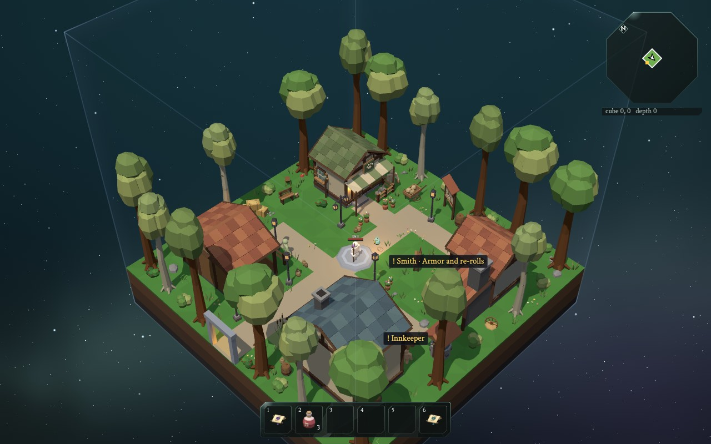
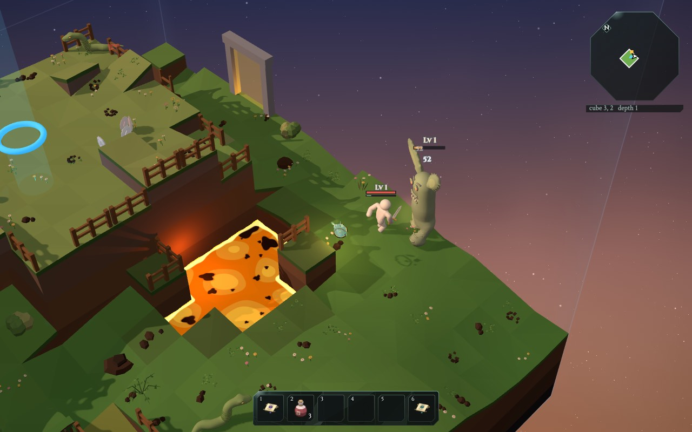

# Cube Crawler

A browser dungeon crawler made of 16x16-cell cubes stacked into themed depths.
Plain ES modules and a vendored three.js; no build step.

**[Play it in your browser](https://mitsuhiko.github.io/dungeon-crawler/)**

<p>
  
  
</p>

This game is AI generated and was made together with my kids. It comes with interactive live
docs that explain how the game works, from the big ideas down to the real code:
**[read the guide](https://mitsuhiko.github.io/dungeon-crawler/learn/)**.

## Layout

- `index.html`, `style.css`, `src/`: the game.
  - `src/core/`: pure rules and data (constants, combat, items, inventory, ...);
    `src/core/gear/` is the weapon generator (rarities, affixes, names, drops; `docs/loot.md`).
  - `src/world/`: the world graph and everything shared between cubes (layout, WFC, faces,
    falls across faces, sites, town plan), plus the worker that owns it.
  - `src/cubegen/`: builds one cube's map from the spec `world/` hands it. Files named like
    a `world/` file (`cascades`, `spouts`, `sites`, `town`) carve that shared decision into the cube.
  - `src/themes/`: per-depth data: palettes, lighting, generator settings, structure materials;
    each world picks one theme per depth from its seed (`themes/depth.js`).
  - `src/physics/`, `src/render/`, `src/game/`: movement, drawing and game state/flow.
    `src/game/teach.js` (`window.__game.teach`) draws over the world, shows the game's rules
    (lenses), pauses / steps / slows time and tunes numbers with a way back, for the guide's tutor.
  - `src/net/`: playing together (hosting in the Esc menu, joining in the main menu, up to four
    players): a room code, PeerJS between the host and each guest, the others' poses,
    following each other through portals and one player's enemies shown to the others in its
    cube (`docs/online.md`).
  - Saves (`src/core/save.js`, `src/game/save.js`): up to three heroes and eight worlds,
    apart, in `localStorage`; each hero remembers its world, goes into any other, a friend's too;
    every seed has its own name (`src/core/names.js`, `docs/saves.md`).
  - Quests (`src/core/quests.js`, `src/game/quests.js`, the inventory's Quests tab in
    `src/game/questpanel.js`, U): the villagers give quests, shared by everyone in the world and
    saved with it (`docs/quests.md`).
  - Skin chooser/painter (main menu: **Choose Skin**, `src/game/skineditor.js`): a pen, color picker,
    closed-outline fill, eraser, rotation and zoom. Paint is a 2048² UV texture, not vertex colors;
    GPU projection carries strokes across UV seams without painting through the body. Fill
    refuses outlines with gaps. Save Skin requires a name; Load Skin restores a named painting
    from the browser's IndexedDB library, including for another hero. Recent Skins lists the
    last 20 saved skins with character previews, newest first. This is the initial Choose
    Skin screen, with a large **Paint Skin** button at the bottom opening the painter.
    Cancel leaves the hero unchanged. Not sent to other players online. See `docs/skins.md`.
  - Settings (`src/game/settings.js`, the menu in `src/game/settingsmenu.js`, from the Esc menu
    and the main menu): the frame rate cap (30, 60 or unlimited, `src/main.js`), the anti-aliasing (MSAA off to
    8x, `src/render/msaa.js`), music on / off,
    the music's and the sounds' volume, and the keys. Every
    control is an action with a primary and a secondary key (`src/core/keybinds.js`: codes, so
    WASD keeps its place on any layout); kept in `localStorage` as `crawler.settings`.
  - The chat box (Enter, bottom left; `src/game/console.js`): the chronicle of what happened,
    chat when playing together, and commands after a `/` that complete the game's items and
    enemies; with `?dev=1` the developer commands (`` ` ``, `/help`; `docs/console.md`).
- `assets/`: exported game data (meshopt-compressed GLB models, manifests, and item icons that only
  the guide uses: the game draws items from their models). The game loads assets only from here
  (and music from `music/`), each when it is first needed: the prop libraries are one file per
  prop set (`assets/props/`, `clutter/`, `themes/`), loaded with the enemy models a cube has
  before it is entered, and its shaders compiled ahead (`src/render/cubeassets.js`,
  `src/render/warmup.js`). These files are generated; do not edit them by hand.
- `music/`: hand-written Scrimshaw scores the game plays (`docs/music.md`). Before writing
  or changing a song, read `music/README.md` for the style, the layers and the format.
- `blender/`: authoring sources: Blender scripts and `.blend` files that export
  into `assets/`, Blender test scripts in `blender/tests/`, renders in `blender/previews/`.
- `tests/`: `node --test` unit tests; `tests/browser/` holds integration checks
  that run from the game's devtools console.
- `tools/`: dev server, the prop metadata generator, the GLB compressor (`compress-assets.mjs`;
  `glb.mjs` reads the GLBs for the tools and tests), the enemy kinds preview
  (`/tools/kinds.html`, see `docs/enemy-kinds.md`), the depth population measurement, the
  weapon drop tables (`node tools/loot-table.mjs`) and the balance simulation
  (`node tools/balance.mjs`, see `docs/balance.md`).
- `docs/`: design notes; `docs/assets/` documents the asset libraries.
- `learn/`: an interactive guide for children (about 12), in English and German, from the
  big ideas down to the real code (`/learn/` on the dev server), with an AI tutor on every page
  (`learn/tutor/`, needs an API key, see `learn/README.md`). Code it
  explains carries a `// learn: ...` marker. After changing such code, run
  `npm run learn` (`npm test` runs it too): it names the slides to review; then
  `npm run learn -- --stamp`, or `-- --defer` to note them as outdated. See `learn/README.md`.
- `vendor/three/`: three.js (r186: `three.core.js`, which the world worker imports by path, and
  `three.module.js` with the renderer) and the addons in use (with the meshopt decoder for the
  GLBs, `addons/libs/`); `vendor/scrimshaw/`: the music score parser and synth;
  `vendor/peerjs/`: PeerJS for playing together, loaded only when someone hosts or joins;
  `vendor/pi-durable/`: Pi's durable agent harness and model access for the tutor, one bundle built
  by `node tools/vendor-pi-durable.mjs <pi checkout>`.

## Running

```sh
npm run serve            # uv run --no-project tools/serve.py [port]
# http://localhost:8000/            the main menu: your hero, its world, joining a friend
# http://localhost:8000/?seed=123   straight into that world, nothing saved
#   (?dev=1 for dev tools: ` opens their commands; it skips the menu too, ?menu=1 shows it)
# ?touch=1 forces the touch controls (docs/touch.md)
# with RADIUS_API_KEY, ANTHROPIC_API_KEY or OPENAI_API_KEY set, the guide's tutor uses it through the server
npm test
```

In a git worktree the server and tests take `assets/` from the main checkout;
see `docs/combat.md`.

## Blender MCP (Pi)

Pi talks to Blender through the [Blender Lab MCP server](https://projects.blender.org/lab/blender_mcp).
With Node.js, git, [uv](https://docs.astral.sh/uv/getting-started/installation/), and
Blender 5.1+ installed, start Pi from the repository root. `.pi/mcp.json` runs
`tools/blender-mcp.mjs`, which automatically:

- Checks out the pinned server and addon revision into `.pi/blender_mcp/src/`
  and installs the server into a Python environment in `.pi/blender_mcp/venv/`
  (both ignored by Git).
- Reuses a running Blender that serves the addon, or opens a new Blender window
  with it. An installed and enabled copy of the addon is used as is; otherwise
  the project checkout is loaded for that session only, without saving it to
  your Blender preferences.

The first launch needs internet access. Keep the Blender window open. To update
the server, change `revision` in `tools/blender-mcp.mjs`; delete
`.pi/blender_mcp/` to rebuild everything.

The launcher detects standard Windows and macOS Blender installs, or uses
`blender` on PATH; `BLENDER_PATH` overrides that. It finds uv in `~/.local/bin`
or on PATH; `BLENDER_MCP_UV` overrides that. It reuses the first port in
9876-9885 that runs the addon and skips ports held by other servers; otherwise it
starts Blender on the first free one. `BLENDER_MCP_PORT` pins a single port. A
remote `BLENDER_MCP_HOST` requires an already running addon there; the launcher
will not start a local Blender for it.

Run `pi mcp list` to check discovery and ask Pi for scene information to verify
the live connection. Use `/reload` after configuration changes in an existing
Pi session. Keep the addon bound to localhost: it allows arbitrary Python
execution. Save your work first.

## Re-exporting assets

The Blender scripts export plain GLBs; `npm run compress-assets` (`tools/compress-assets.mjs`)
then compresses every one not compressed yet with meshopt (gltf-transform through `npx`: the
vertices are quantized, geometry and animation meshopt-encoded; `src/render/gltf.js` decodes them),
keeping each prop's exact bounds in its extras, and regenerates the prop metadata
(`src/core/propmetadata.js`, also `npm run prop-metadata`). A test fails on an uncompressed GLB.

```sh
Blender -b --python blender/props.py          # likewise character, spider, stunder, snake, octonaut,
                                              # fireface, triangle, firecat, shraps, spicy, wolla, wolk, gusto, sword
Blender -b --python blender/clutter.py        # libraries: clutter, items, town, town_trees
Blender -b --python blender/tests/test_clutter.py
Blender -b --python blender/themes.py         # the alternative themes' library and every theme's
                                              # landmarks (assets/themes/; see docs/assets/themes.md)
npm run compress-assets                       # after any export, before committing
Blender -b --python blender/loadout.py        # the player with each kind of weapon and the
                                              # villagers (previews; -- --mounts solves the mounts
                                              # of weapons and worn / held things)
```
