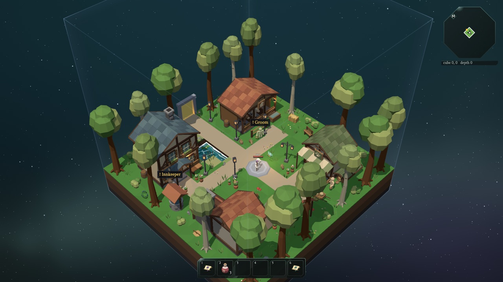
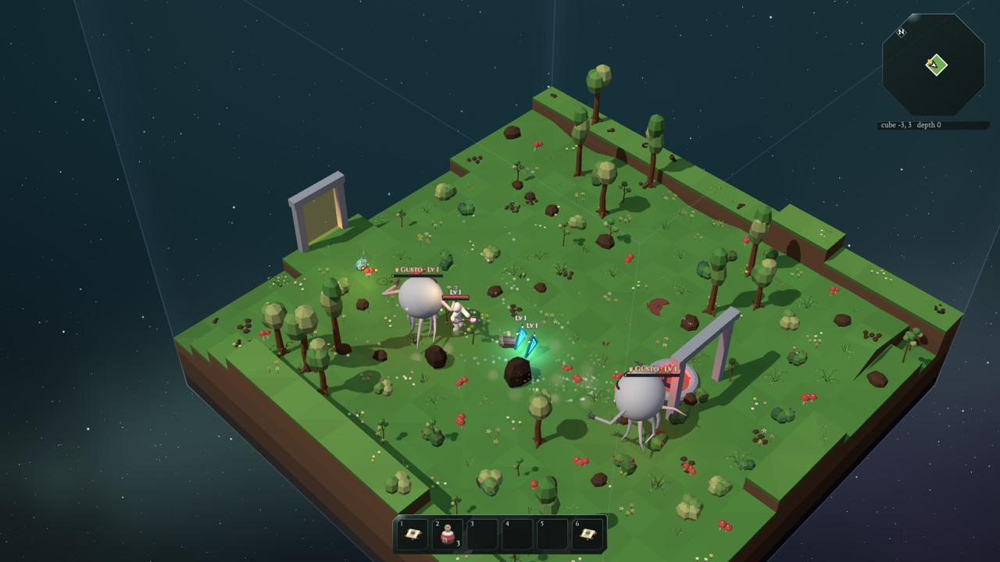
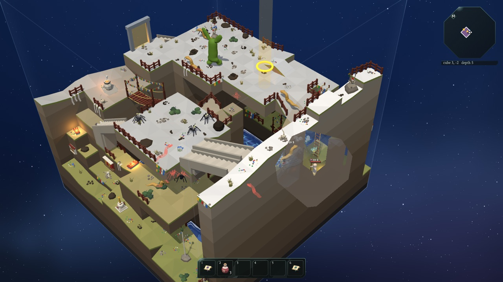
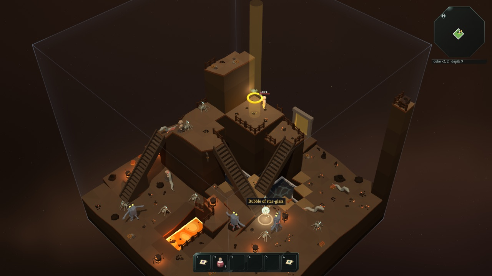

# The Glass Bird

A dungeon crawler for the browser. The world is made of floating cubes stacked into twenty depths,
each with its own theme: meadow islands, snowy peaks, prayer highlands, root caves, a dwarven forge
and many more. Starting in a little town, you head down to the core past monsters, guardians and
bosses, collecting weapons and armor and solving trial rooms along the way. A glassmaker's
recordings and a small clockwork robot tell the story. Up to four friends can play together.
The game is in English, German and Indonesian.

**[Play it in your browser](https://mitsuhiko.github.io/dungeon-crawler/)**

  
  
  
  

## Learn how it works

The game was made with AI, together with my kids. It comes with an interactive guide for children
(about 12), in English and German, that explains how the game works, from the big ideas down to
the real code. Many of its demos run the game's own code, and every page has an AI tutor to ask
questions (with your own API key, entered in its settings):
**[read the guide](https://mitsuhiko.github.io/dungeon-crawler/learn/)**.

## Contributing

`npm run setup` gets a fresh checkout going (and says what to install). [CONTRIBUTING.md](CONTRIBUTING.md)
covers how the repository is laid out, how to run the game and the tests, and how to work on the
models.
