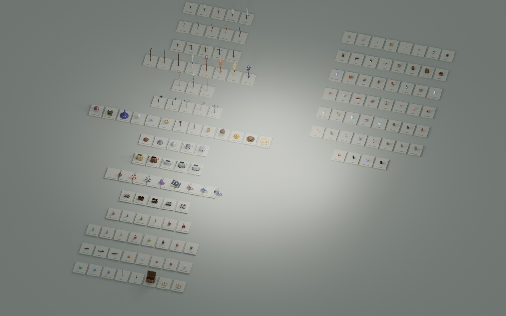

# Loot, equipment, worn things and quest items



Built and inspected through Blender MCP. Matches the existing flat-faceted,
texture-free clay style: warm timber, leather wraps, muted brass and steel,
soft gemstone colours and opaque stylised potion glass. The treasure chest is the
one animated asset.

## Assets

| Group | Named variants |
|---|---|
| Wooden sticks | `item_stick_short`, `item_stick_forked`, `item_stick_long` |
| Coins | `item_coin_gold`, `item_coin_silver`, `item_coin_copper` |
| Crystals | `item_crystal_ruby`, `item_crystal_diamond`, `item_crystal_emerald`, `item_crystal_sapphire`, `item_crystal_amethyst` |
| Swords | `weapon_sword_short`, `weapon_sword_medium`, `weapon_sword_long`, `weapon_sword_broad`, `weapon_sword_greatsword` |
| Bows | `weapon_bow_short` (plain self bow), `weapon_bow_hunting` (bark, green cloth and feathers), `weapon_bow_recurve` (brass tips), `weapon_bow_long` (pale yew, horn nocks), `weapon_bow_war` (dark horn, iron bands and spikes, red wrap) |
| Crossbows | `weapon_crossbow_hand` (small, brass), `weapon_crossbow_light`, `weapon_crossbow_repeating` (bolt magazine and lever), `weapon_crossbow_heavy` (iron prod, stirrup), `weapon_crossbow_arbalest` (steel prod, stirrup, windlass) |
| Staffs | `weapon_staff_gnarled` (crooked branch, green stone), `weapon_staff_oak` (brass prongs, blue orb), `weapon_staff_ember` (dark wood, ruby flame), `weapon_staff_crystal` (birch and silver, clear shards), `weapon_staff_arcane` (forked wood, brass collars, amethyst head) |
| Ammunition | `weapon_arrow`, `weapon_bolt` (what bows and crossbows shoot in the game) |
| Potions | `item_potion_health` (red, round), `item_potion_mana` (blue, tall), `item_potion_stamina` (green, square), `item_potion_health_minor` (slim vial), `item_potion_health_greater` (deeper red, gold band and cap), `item_potion_health_superior` (crimson cone, gold, a star over the heart), `item_potion_antidote` (teal, a cross), `item_potion_swiftness` (sky blue, a wing), `item_potion_haste` (amber vial, a bolt), `item_potion_might` (rust red, iron band, a sword), `item_potion_leaping` (lime cone, an arrow up) |
| Flasks | `item_flask_blast` (smoky glass, iron bands, a lit fuse), `item_flask_fire` (orange, a rag in the neck, a flame), `item_flask_toxic` (green, wax seal, bubbles, a skull); held by the neck to throw (extras `weapon: 'throw'`, `mount_*`, see [potions.md](../potions.md)) |
| Treasure chest | `treasure_chest` (empty, lid on a hinge, `Open` / `Close` clips) |
| Tools | `item_town_portal` (parchment scroll on two rollers, violet portal sigil, wax seal), `item_room_portal` (the same scroll with a teal sigil and seal) |
| Headwear | `wear_headscarf` (plum kerchief with golden dots, knotted at the nape), `wear_welding_mask` (flat olive shield, dark green window, headband and crown strap), `wear_wizard_hat` (indigo, drooping brim, gold band and stars, bent tip) |
| Held | `held_towel` (striped, folded over a forearm), `held_crystal_ball` (faceted, three shards circling it), `held_rope` (a coil with a loose, frayed end), `held_hammer`, `held_pliers` (holding a glowing billet), `held_feed_bag` (burlap, grain and a carrot) |
| Headwear of the people out in the world | `wear_hood` (a pilgrim's rough brown hood, open round the face, its point falling back), `wear_miner_helmet` (hard yellow dome, ridge, short brim, a lamp in front that glows), `wear_explorer_hat` (felt, wide brim turned up at one side, dented crown, red feather), `wear_straw_hat` (wide woven brim, low crown, cord band) |
| Quest items | `quest_locket` (gold heart, ruby, its chain beside it), `quest_toy_rabbit` (a sitting plush rabbit, one ear flopped, blue ribbon), `quest_letter` (sealed envelope, red wax), `quest_parcel` (brown paper, twine and a bow, a label), `quest_map_scrap` (torn parchment, an inked way, hills, a red cross), `quest_ring` (gold, on its edge, a blue stone), `quest_compass` (brass, lid open, glass over the needle), `quest_journal` (leather, strap and buckle, a ribbon marker); category `quest`, lying on the ground like loot |
| Quest things made from props | 44 (`QUEST_PROPS` in `blender/items.py`): each built by the same builder as a world prop (`props.py`, `clutter_*.py`, `themes_*.py`), scaled to a longest side of 0.4, its glowing faces on a fourth material `<name>_glow` in the prop's light colour, and a red bow with a paper tag tied on its top, so it never passes for the clutter it looks like (the game adds a gold glow, `src/render/loot.js`). Three have builders of their own where the prop is more than the thing: `quest_lantern` (off its post), `quest_pickaxe` (out of its rock), `quest_wagon_wheel` (out of the sand). From `quest_backpack` to `quest_rune_stone`; the names are in `src/core/items.js` |

**115 assets / 44,882 triangles total.** Sticks vary in length and branching; gemstones have
distinct cuts; swords vary in blade length, width, guard and grip, not just scale; bows in
length, bend and recurve; crossbows in stock, prod and fittings; staffs in their heads.

## Treasure chest

`treasure_chest` is an empty, hollow chest: the root mesh is the body, its one child
`treasure_chest_lid` sits on the hinge (`hinge_gltf`, glTF `[0, .445, -.3]`) with its
vertices relative to it, so rotating it about its local X opens it. Two clips animate only
the lid's rotation (24 fps, sampled):

- `Open` (~1 s): a small unlatching rattle, a swing back past the stop to -114°, settling at -108°.
- `Close` (~0.75 s): a lift off the stop, an accelerating fall, a slam and a short bounce.

At rest (no clip) the lid is closed. Its floor is at `contents_gltf` (`[0, .118, 0]`),
`contents_size_gltf` (`[.84, .49]`, x by z) across, for putting things inside later. The
game builds each chest as its own object, not an instance, and plays the clips with an
`AnimationMixer` (`src/render/chests.js`); collision uses the closed bounds.

The game never puts tools on the floor: the portal scrolls' models only show them in the bag.

## Files

- `blender/items.py`: deterministic source; uses sibling `props.py` and `town.py` helpers.
- `blender/items.blend`: editable, labelled showroom with camera and lighting.
- `assets/items.glb`: complete library, all 115 named roots at the origin.
- `assets/items/<name>.glb` and `<name>.png`: standalone exports and individual previews (256 pixels;
  the overview is 1600 by 1000, the quest things in a block of their own on the right)
  (the kids' guide uses a few of the PNGs as room pictures; the game and the guide's demos draw
  every item from its model, `src/render/itempictures.js`).
- `assets/items/manifest.json`: names, triangles, authoring bounds, sizes and unit/scale contract.
- `blender/previews/items-preview.png`: overview render (local, not committed; the picture above
  is a copy in `learn/img/`, `node tools/preview-images.mjs`).
- `blender/tests/test_items.py`: geometry, repeatability and actual binary GLB validation.

Every asset is one flat-shaded Blender mesh (the chest: two, body and lid; bows: two, with
the string; crossbows: three, with the string and the loaded bolt), with vertex colours, baked
geometry, and no textures, UVs, rigs, modifiers or external dependencies. Only the chest lid
is animated.
There are up to three material primitives (clay, metal, gemstone/glass); a glTF
loader may expose a root group with multiple mesh children. Keep that root when
instancing or attaching equipment. Preview plinths, labels, lights and floor
are excluded from all GLBs.

## Units and pivots — important

Export is **Y up**, with Blender `(x, y, z)` mapped to glTF `(x, z, -y)`.

- **Loot and chests:** one unit = one game cell; `game_scale=1`. Origins are
  ground-centred, with exported ground at Y=0. Front is glTF +Z.
- **Weapons and arrow:** use the same unscaled rig units as `character.py` /
  `sword.py`. `game_scale=.55` when placed directly in the game world. When
  attached under the already-scaled character, keep local scale **1**, not .55.
- **Weapons:** origins are grip centres (where the fist holds them). Every weapon's extras say
  its `socket` (`hand.L` for bows, `hand.R` for the rest), `mount_quat_gltf` (its rotation in
  the socket bone, glTF x y z w; `MOUNTS` in `blender/items.py`, solved by
  `blender/loadout.py --mounts`) and `attack_clip` (Slash, Shoot, CrossbowShot, Cast).
- **Swords / staffs:** blade / staff length runs along glTF +Y (Blender +Z). Swords sit at the
  -π/6 grip rotation about X (60 degrees from the forearm). Staffs carry `head_gltf`, where
  their spell leaves.
- **Bows:** lie in XY after export, with +X forward (the belly) and the limbs along ±Y; the
  string runs straight behind the grip from `string_tip_gltf` to `nock_gltf` and on to the
  tip mirrored in Y. The string is its own part (`<name>_string`, `parts` extra), so the game
  can hide it and draw it pulled.
- **Crossbows:** forward is glTF +Y, the top (where the bolt lies) +Z, the prod across X. The
  string runs from `string_tip_gltf` (mirrored in X for the other tip) to the nut
  (`string_latch_gltf`) when drawn, to `string_rest_gltf` when shot; `muzzle_gltf` is the
  loaded bolt's tip. The string and the loaded bolt are parts (`_string`, `_bolt`).
- **Arrow / bolt:** origin is the nock, not a grip; glTF +Y points towards its head.
  Rotate to match the shot direction when placing on the bow or firing.
- **Headwear and held things** (`WEARS` in `blender/items.py`; how the game puts them on:
  `docs/villagers.md`): headwear is modelled around the head's centre (Blender Z up, the face
  towards -Y), held things around the fist. Their extras say the `slot` (`head`, `right`,
  `left`), the `socket` bone (`head`, `hand.R`, `hand.L`), `mount_quat_gltf` and
  `mount_offset_gltf` (rotation and offset from the bone's root, rig units; solved by
  `blender/loadout.py --mounts` from `WEAR_AIMS`), and for held things the arm's `hold` pose
  (the character's `Hold<Name>` clip). The crystal ball adds `float`, how high its centre
  hovers over the fist. A glowing part (the ball, the billet) is the `Items_Facets` material.
- Blender bone parenting is bone-tail-relative: when attaching directly to the
  rig in Blender, apply the same tail compensation as `sword.attach()`.

GLB extras include `cube_crawler_item`, `category`, `attach`, `units`,
`game_scale`, `blocking`, `radius`; equipment adds `weapon`, `socket`, axis
and grip hints; worn and held things `slot`, `socket`, the mount, `hold` and `float`. Potions add `potion_type`; the chest adds `clips`, `lid`, `hinge_gltf`,
`contents_gltf` and `contents_size_gltf`. These are metadata,
not implemented inventory effects, collision or combat rules.

All twenty weapons are base types for generated weapons, alongside the Glassmaker's Old Sword found in
the merchant camp (`assets/sword.glb`). The game mounts them in their socket and switches combat
stats with equipment; on the floor they lie flat, glowing by rarity (see `docs/loot.md`). The
arrow and bolt are what bows and crossbows shoot (`render/shots.js`; a nocked arrow also lies on
a drawn bow). With `?dev=1`, open inventory (`I`) to roll and equip any weapon. Coin types and
stackable potions/sticks/crystals have inventory definitions;
coins normalize automatically. Potions/materials have no use actions yet; reward sites place
the chest (`docs/loot.md`). How the player holds and uses each kind: `docs/combat.md`.
See `docs/progression.md` for inventory and balance rules. The headwear and held things are
items too (`core/items.js WEARABLES`), worn for now only by the villagers (`docs/villagers.md`).

## Rebuild / validate

```sh
Blender --background --python blender/items.py
Blender --background --python blender/tests/test_items.py
npm run compress-assets                        # then compress (CONTRIBUTING.md)
```

Via the interactive Blender MCP execute tool:

```python
import sys, importlib
sys.path.insert(0, '/absolute/path/to/dungeon-crawler/blender')
import items
importlib.reload(items)
items.main(render=False)  # saves .blend and combined + individual GLBs
```

Default `main()` also renders the overview and 47 individual previews (`main(render=False)`
skips them, e.g. after changing only extras such as `MOUNTS`). Tests
run in an isolated Blender process and export only into a temporary directory.
They check deterministic geometry/colours, triangle budgets, flat normals,
nondegenerate triangles, ground/grip/nock pivots, Y-up bounds, named roots,
extras, the chest's lid hinge and clip end poses, no preview objects/textures/UVs, and selection/visibility/layout
restoration after exporting.
