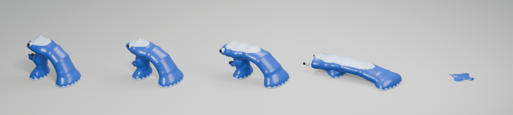
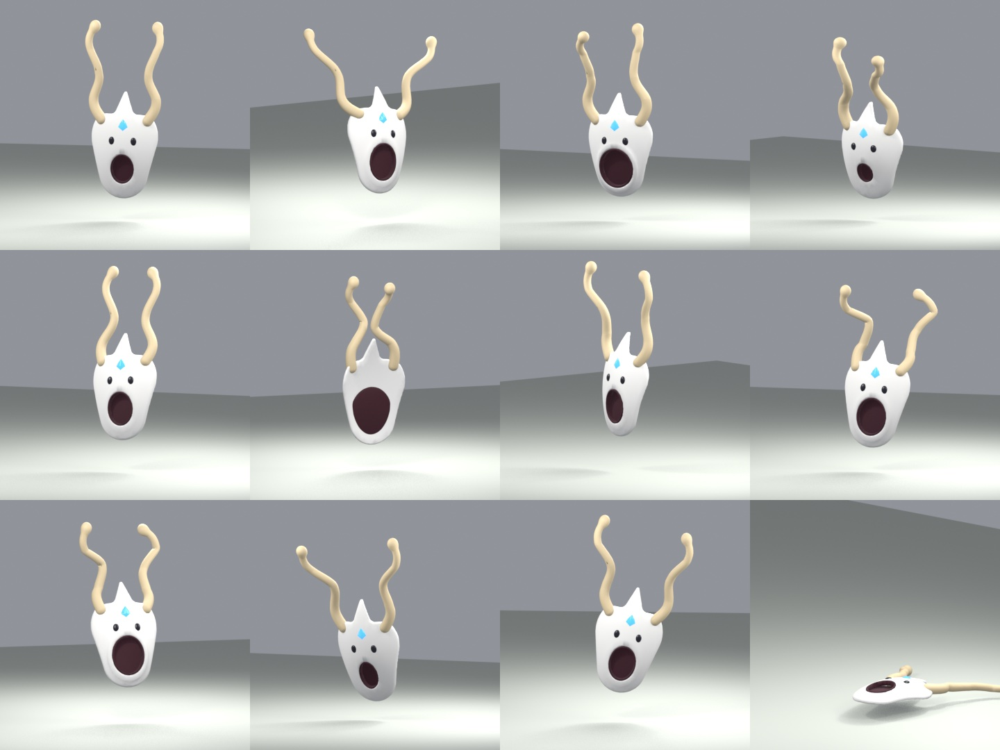
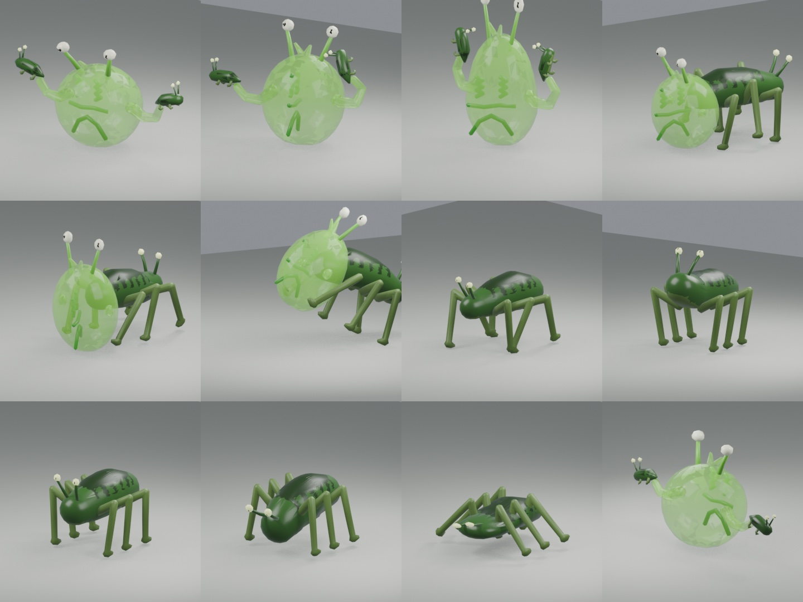

# Bosses

A real boss takes the place of one depth's descent guardian; the other descent guardians stay
boss placeholders ([guardians.md](guardians.md)): the game calls them **Temp Bosses**
(`♛ Temp Boss Spider`), as they hold the place of bosses to come. `BOSSES` in `src/core/bosses.js` says which
depth has which: so far the first descent, on the road out of town (depth 0), has **Gusto**, the
second (depth 1) **Totnar**, the third (depth 2) **Squarlo**, the fourth (depth 3) **Flip**, the
fifth (depth 4) **Foggery**, the sixth (depth 5) **Renew** and the seventh (depth 6, the last of
act I) **Mansk**; at the bottom of act II (depth 13) **Slomo**. A boss may bring an arena of its own
(`BOSS_ARENAS`: Squarlo's tidal hills, Flip's box, Foggery's caldera, Mansk's museum, Slomo's slime
bowl), or only braziers lit round the one his depth has (Totnar, Renew).

The layout marks that arena's guardian with `boss` (`world/layout.js`, `cubegen/guardian.js`;
`bossPlaceholder` is false there). The boss stands on the guardian's spot **alone**: no
defenders, it brings its own (`game/enemyspawn.js` `bossSpot`). It is a guardian in every other
way: the descent guardian's level, id, gate, seal, amber HP bar and drops; its death alone opens
the well, for good. Its label shows its name (`♛ Gusto · Lv 1`), the locked well says
"Defeat Gusto to unlock this descent", and the music turns to the boss mood like for any
guardian, unless the boss has a song of his own (Gusto: `music/gusto.scrim`, its moods his
fight's phases, `docs/music.md`). Beating any boss plays a jingle (`src/audio/jingles.js`,
`docs/sound.md`). Once hurt, or once it has struck, it no longer keeps to its post
(`game/defence.js`); out of his arena (a dev spawn, the boss test room) he fights on the same (`relentless`,
`game/enemyai.js decide`).
Like every guardian's arena, leaving it while the boss lives asks first, and being pushed against
the entrance never takes you out ([guardians.md](guardians.md#encounter-and-persistence)).

Each boss runs its own fight (`game/gusto.js`, `game/totnar.js`, `game/squarlo.js`, `game/flip.js`,
`game/foggery.js`, `game/renew.js`, `game/mansk.js`, `game/slomo.js`, its rules in `core/gusto.js`, `core/totnar.js`, `core/squarlo.js`,
`core/flip.js`, `core/foggery.js`, `core/renew.js`, `core/mansk.js`, `core/slomo.js`); what they share is `game/bossfight.js`: the players in the fight, sending a
body into it, the floors a body fits on, putting minions down round their boss and letting
bodies go. A boss's minions (`minion` kinds, summoned) live in no roster: they pay a little XP
once, no coins, no weapons, now and then a minor health potion, and go with their boss when it
dies.

## An arena of its own

A boss's arena is drawn from a shape like any guardian's (`cubegen/arenashapes.js`: Squarlo's
tidal hills are `BOSS_SHAPES.tidal`; a shape may name what its floors are built of, `surface`:
Mansk's museum, `BOSS_SHAPES.stage`) or built by a generator of its own (`OWN_ARENAS` in
`cubegen/guardian.js`: Foggery's caldera, `cubegen/towerarena.js`; Flip's box,
`cubegen/fliparena.js`). Either way it looks like the theme of its depth:

- **Colours come from the theme, never from the generator.** The terrain's colours go by height
  (grass tops, cliff strata, snow up high); what a generator builds has no height to go by (a tower
  from the floor to the top of the cube, a box that turns any side up), so its floors name what
  they are built of (`f.surface`) and `themes/surfaces.js` says the colour: `masonry` (built
  stone), `paving` (a checker of two tiles), `trim` (caps) and `crust` (dark ground by lava).
  Every theme has them, made from what it has anyway (its structures' stone, its rock, its
  underside); a theme may set its own (`surfaces` in `themes/index.js`). The renderers take them
  from the map's theme (`render/palette.js` `SURFACE`, `surfaceColors`), and footsteps go by them
  too (`core/footing.js`: masonry and paving are stone, crust gravel). No colours in `cubegen/`
  (`tests/arenasurfaces.test.js` builds every boss arena in every theme of its depth).
- **Props come from the theme's sets**, and from the sets the boss brings
  (`BOSS_ARENAS[boss].props`: Foggery's volcanic rocks); `cubegen/arenaprops.js smallProps`
  picks their small loose things. Neutral `any_` props are tinted the theme's rock
  (`themes/surfaces.js rockTint`).
- **The map is made by `finishArena`** (`cubegen/arenamap.js`): the way from the doorway to the
  way on, the routes, and everything the rest of the game reads off a map, the theme's stamp
  `biome` above all.

A new arena of its own: a generator taking `{ spec, ctx, role, own, entry, exit, level }` (and
`{ U, approach, R, frame }` unless it is `bare`, building from the doorway alone), returning
`finishArena(...)`, named in `OWN_ARENAS` and given to its boss as `BOSS_ARENAS[boss].type`.
What belongs to the fight rather than the place (lava's glow, ice panes, black holes, runes)
may have colours of its own.

## Gusto


From the kids' whiteboard sketch (`blender/gusto.py`, `assets/gusto.glb`): a big round,
white-grey head with a V of angry brows, glowing red eyes and a wide grin of jagged teeth
(upper row down, lower row up, interlocking). Two long thin arms come out of its sides and end
in four dark claws. Eight thin tentacles hang from its underside: it floats (`hover`), they never
touch the floor, and they move like crazy: the clips only sway them, the game shakes every
tentacle bone on top of whatever clip plays (`flail`, `render/enemies.js`). About 2.3 cells
tall. Its eyes flare up while it winds up an attack.

Profiles: `GUSTO` and `GUSTO_SPLIT` (phase 2) in `src/core/enemies.js`; the fight's rules in
`src/core/gusto.js` (`GUSTO_FIGHT`); the fight itself in `src/game/gusto.js`. His arena has
his own song (`music/gusto.scrim`, 150 bpm): a music box and a heartbeat while he waits, the
full band from his first move, a held cluster while he splits, doubled drums and a theremin
for the three of him, a hush when he vanishes (`gustoMusic`, `docs/music.md`). Unlike the
other bosses' arenas, his has the world's days and nights (`BOSS_ARENAS.gusto.days`,
`game/daycycle.js`): his fight has no light of its own.

| | Level 1 |
|---|---|
| Health | 1000 (the descent tier's floor) |
| Damage | 24 (grab ×1.2, vortex ×0.5; breathing in: none) |
| XP | 650; coins 120–220; two weapons and two potions like a descent guardian |
| Poise | 2 s |

### Phase 1 (full health to half)

- **Grab and throw** (within 1.6 cells, clip `GustoGrab`, 2.2 s): it spreads its arms wide and
  leans back (the tell), lunges and catches at 0.73 s whoever is within 1.8 cells in front of it.
  Caught, the player is held in its hands (`game/grab.js`): no moving, no striking, nothing else
  hurts them, and there is no wriggling free. It lifts them up high in front of its face along
  the clip's grip path (`grab.grip`, read off the clip by `blender/gusto.py`) and at 1.53 s throws
  them down in front of itself: then the blow lands (29 at level 1) and they go over as a
  ragdoll and get up as after any knock-down. A stagger (a heavy blow, a friend's) or its death
  makes it let go: the player drops unhurt.
- **A grab that catches nothing** (the grab's `miss`, `game/enemyai.js whiff`): it goes on into
  `stuck` (clip `GustoStuck`, 2 s): from the catch pose it overshoots and face-plants, arms splayed
  on the floor, tentacles flopping, and heaves itself back up. Until 1.6 s (`exposed.until`)
  every weapon blow does ×2 (`exposed.damage`, `core/combat.js weaponHit`, the number shown is
  the bigger one) and none staggers it out of this (`damageEnemy`). Every game shows the crash
  (`game/gusts.js`, `felledFx`: a thump, dust) and says "Gusto missed! Hit him while he is
  down". So reading the tell (arms flung wide and up) and stepping out of reach pays, with any
  weapon; a proxy that misses falls the same way.
- **Breathing in** (`inhale`, within 2 to 9 cells, clip `GustoInhale`, 2.4 s), also in phase 2:
  once the nearest player has kept more than 4 cells (`GUSTO_FIGHT.far`) from it for 3 s
  (`wait`), it starts nothing else (`barred`, `game/gusto.js`). The tell: it sweeps its arms
  back behind it, tips its face up and empties itself; at 0.5 s it lunges its face forward, arms
  out to scoop, and for 1.3 s sucks in whoever stands in the cone before its mouth (9 cells long,
  0.7 either side at the mouth widening by 0.5 per cell) with a clear line to it, swelling all
  the while, then gulps. Pulled at 4 cells/s (`pull.speed`) up to 1.5 cells from it
  (`pull.stop`); away from it the player keeps only a quarter of their steering (`pull.hold`),
  but sideways all of it, and it stops turning at 1 s: stepping out of its breath escapes. It
  does no harm; it recovers in 0.2 s (`recover`), and for 1.5 s after it only a grab may start
  (`follow`). One of the three at a time, every 8 s at most (`breathCool`). Every game pulls its
  own player off the attack clock (`player.pull`, `physics/move.js`), so nothing is sent.
  Shooting from afar is still the safer way, but it no longer keeps the player out of his hands.
- **Summon** (within 8 cells, clip `GustoSummon`): it rears back with its arms up and spits Custo
  triangles from its mouth at 0.9 s, onto free floors around it: as many as fill up to **three**.
  It summons again only while fewer are about, at most every 7 s (the first after 1.5 s of
  fighting).
- No blow takes it below half its health (`hpFloor`, `core/combat.js` `damageEnemy`).

### The split

At half its health it stops, shudders and steams (mode `split`) and nothing hurts it for 1.8 s.
Then **three Gustos** appear on spots of the fight zone at least 3 cells apart from each other
and from the players (closer where the arena does not allow that): the real one on any of them,
and two **proxies**.

### Phase 2 (half health to death)

- All three fight the same: the grab, the **vortex**, the summon and breathing in. Their attacks are out of
  step, so they do not all blow at once.
- **Vortex** (from 2 to 4.4 cells, clip `GustoBlow`, 2.1 s; closer he grabs instead): it brings both hands up in front of its
  mouth and breathes in from 0.3 s (air spirals into its hands, it swells), and at 1 s blows a
  vortex through them for 0.6 s: a gust like the Wolla's (`core/gusts.js`, `game/gusts.js`,
  kind `vortex`), 5 cells long, 0.45 either side at the hands widening by 0.4 per cell. A player
  in it is hit once (12 at level 1) and blown back at 7 cells/s fading over 0.7 s (about 2.5
  cells). It stops turning at 0.85 s: stepping out of the cone then dodges it.
- Summons now fill up to **two** Custo triangles; any of the three can summon.
- **Proxies** look exactly like it, carry its name and show its health (their bars drop with
  its own). Any hit at all, however small (a burn tick too), makes one go up in a cloud: no XP,
  no loot. The real one takes damage like any enemy: the play is to find it, and mostly to beat
  it while one proxy still stands.
- When the **second proxy** goes, the real one can still be hit for **1.5 seconds** (if it is in
  the middle of an attack, until that is over). The time a player spends within 2.5 cells of it
  (`GUSTO_FIGHT.close`) does not count, for up to 4 s more (`hold`): a sword that popped the last
  proxy gets to him and strikes, a bow from afar gets no more. Then it vanishes in a cloud (mode `gone`: it
  cannot be seen, hit or touched; `absent` in `core/enemies.js`), and 1.3 s later it and two new
  proxies appear on new spots, as after the split. For 0.5 s after appearing nothing hurts them.
- Its death takes its proxies and triangles along, in clouds (no XP for them).

### Without a bow

A hero who reaches him with only a sword or a flail must still stand a chance (most see a bow,
crossbow or staff before him, not all: [balance.md](balance.md)). So the fight leans towards
those up close: the grab, which a sword has to live with, hurts less (×1.2) and a dodged one
lays him open for twice the damage; up close he grabs rather than blows his vortex, which
blows less far; and the last proxy gone, he waits for a player standing at him (`close`,
`hold`). A bow keeps its own ways: it shoots the proxies from afar, and his breath brings it in.

## Custo triangle

`CUSTO_TRIANGLE` (`src/core/enemies.js`): a kind of the Triangle, half its size, light blue,
1.9× as fast, with a weaker, faster punch (9.5 cells/s) that does **not** knock the player over.
It lives in no roster (`minion`): only Gusto brings them, and they go for the player at once.
Each pays a little XP (11 at level 1) once (`awarded`; never remembered as defeated), no coins
and no weapons, and drops a minor health potion 8% of the time (`drops`,
`core/gear/drops.js`). All the real XP is Gusto's.

## Totnar


From the kids' whiteboard sketch (`blender/totnar.py`, `assets/totnar.glb`): a tumbleweed, a
ball of tangled sticks and clumps of dry leaves, about 2.4 cells tall with his skulls. In the
middle burns his heart, a red hexagon of embers in a pentagon of thick sticks; three skulls
float above the ball, side by side, bobbing out of step and clacking their jaws; two long stick
arms with twig fingers come out of his sides. The game rolls the ball by the distance he covers
(`tumble`, `render/enemies.js`: the bone `brush`), and he sheds leaves and twigs as he rolls
fast (`litter`). His skulls glow faintly, so they show in the dark.

The sticks lie in three layers round the heart. Each time he loses a skull, one shell of
sticks goes with it (`shed`: the bones the game scales away at each stage, with a burst of bone
shards or sticks and leaves and a crack): stage 2 loses the right skull and the outer shell,
stage 3 the left one and the middle shell. So his heart shows more and more, and its light
grows (`grow` in `render/enemies.js` GLOW).

Profile: `TOTNAR` in `src/core/enemies.js` (all his attacks on one profile; the fight bars
those not of his stage); the fight's rules in `src/core/totnar.js` (`TOTNAR_FIGHT`); the fight
itself in `src/game/totnar.js`.

| | Level 3 |
|---|---|
| Health | 1340 (the descent tier's floor, grown two levels) |
| Damage | 29 (skull ×0.7 and a push, roll ×1.3 and a knock-down, lightning ×0.9 and a stun) |
| XP | 650 grown; coins 140–240 at level 1; two weapons and two potions like a descent guardian |
| Poise | 2 s |

### The dark

All fight long he makes it dark, and after a while light again: the gloom (clip
`TotnarGloom`, 1.7 s; any distance, any height): he spreads his arms high, the ball swells and
the skulls gape, and at 0.9 s he sweeps his arms down. The darkness is sucked into his heart (or
the light bursts out of it) and the whole cube turns to night over a second or so
(`state.dark`, `render/look.js` NIGHT): the sky and the sun all but go out, the far side sinks
into the dark, stars come out. What still shines are the fires, his heart, the skulls' eyes, the
lightning and the player's own light (at its brightest meanwhile). Five braziers burn round the
edge of his arena (`BOSS_ARENAS`, `cubegen/arenaprops.js`), away from his post. He first makes
it dark 3 s into the fight; the light lasts 5–9 s, the dark 8–13 s. When it is due he starts
nothing else. Each time he loses a skull it is light at once, for 6 s at least; his death
brings the light back for good.

### Stage 1: three skulls (full health to two thirds)

- **Skull throw** (within 7.5 cells, clip `TotnarThrow`, 1.4 s): he reaches into his sticks with
  the right hand, pulls out a skull, draws it back over his head and hurls it at 0.8 s. It flies
  tumbling at 7.5 cells/s (turned to cross his aim where the player is, `converge`). A hit hurts
  (20 at level 3) and pushes the player back at 7 cells/s fading over 0.45 s.
- Wherever it ends (a player, the level, its range), it comes to life: a **snapping skull**
  (`becomes`, `game/projectiles.js` tells him, `game/totnar.js`) on the nearest free floor, at
  most four at a time. It hops after the player and bites (with a little pounce); after 7 s it
  crumbles in bone dust.
- No blow takes him below two thirds of his health (`hpFloor`).

### Losing a skull

At two thirds (and at a third) of his health he stops (mode `split`): a skull bursts off him
with a shell of his sticks, nothing hurts him for 1.6 s, and the light comes back. Then he
fights on with the next stage's attacks.

### Stage 2: two skulls (two thirds to a third)

- The skull throw and the dark, as before.
- **Twig spiders** (clip `TotnarSummon`, 1.6 s): he grips his own ball and tears it open,
  shaking, and at 0.9 s small spiders of twigs pour out of it (Spiders at 0.55×, fast and weak)
  onto the floors around him: as many as fill up to **eleven**, every 9 s at most.
- **Roll** (from 1.6 to 8 cells, clip `TotnarRoll`, 3.5 s): he crouches, tucks his arms in and
  pulls his skulls down while the ball spins up in place (the tell), and at 0.8 s rolls at the
  player at 7 cells/s, turning towards them at no more than 0.8 rad/s. What stops him (a wall, an
  edge: he never rolls off one) bounces him off, towards the player if they are that way, with a
  thump and dust; after two bounces the next stop ends the roll. Whoever he touches is run over
  (37 at level 3) and knocked down, once a roll. While he rolls no blow staggers him (`steady`,
  `core/combat.js damageEnemy`); a heavy blow in the wind-up still stops it. At 2.6 s he stops
  and sits dizzy, skulls circling, until the attack is over: the time to hit him.

### Stage 3: one skull (a third to death)

- No more throws and rolls; the snapping skulls left crumble.
- **The storm** (within 9 cells, clip `TotnarStorm`, 1.9 s): he raises his arms, his heart
  flares and his skull gapes at the sky. From 0.4 s three storm clouds gather high above the
  player and two spots 1.4–2.4 cells round them, each with the Wolk's crackling ring on the floor
  (`bolts`, `sky`, `core/beams.js`, `game/beams.js`); the rings follow the player for 0.65 s and
  hold still for the last 0.35 s. At 1.4 s the lightning strikes out of the sky: whoever is in a
  ring is hurt (26 at level 3) and stunned for 0.8 s; the thunder rolls in after. A stagger puts
  the storm out.
- **Bramble stunders** (the summon's clip): Stunders at 0.72×, weaker, whose rams do not knock
  you over: as many as fill up to **two**.
- The dark, as before.

His death takes his minions along (in dust and leaves) and brings the light back.

## Totnar's minions

All three live in no roster (`minion`), pay a little XP once and drop a minor health potion now
and then (`drops`); they turn up and go in a puff of dust and leaves, the skulls in bone dust
(`puff`, `render/enemies.js`).

| | Kind of | Size | Notes |
|---|---|---|---|
| Snapping skull | its own species (`SNAP_SKULL`, `assets/snapskull.glb`) | 0.55 tall | hops and bites, crumbles after 7 s |
| Twig spider (`TOT_SPIDER`) | Spider | 0.55× | twig brown, ember eyes, ×0.4 health, ×1.2 speed |
| Bramble stunder (`TOT_STUNDER`) | Stunder | 0.72× | no knock-down, ×0.55 health and damage |

## Squarlo


From the kids' whiteboard sketch (`blender/squarlo.py`, `assets/squarlo.glb`): a tiny teal
fellow, about 0.7 cells tall, smaller than the player. A tall, boxy body splits at the bottom
into two short, stubby legs; a floppy cap on top bends over to his right and ends in a round
bulb; his face is three dots (two glowing eyes and a nose between them); two short arms bend up
at the elbows into cupped hands. In his second phase the game draws the same model about nine
times as big (`SQUARLO_GIANT` `size`): a giant six cells tall.

Profiles: `SQUARLO` and `SQUARLO_GIANT` in `src/core/enemies.js` (`STAGE_PROFILES`: one for each
of his stages); the fight's rules in `src/core/squarlo.js` (`SQUARLO_FIGHT`); the fight itself in
`src/game/squarlo.js`, his water in `src/game/tide.js`, the giant's shockwaves in
`src/game/quakes.js` (drawn with his water cannon by `render/giantfx.js`), drowning's rescue in
`src/game/fluidrescue.js`.

| | Level 4 |
|---|---|
| Health | 1510 (the descent tier's floor, grown three levels) |
| Damage | 31 (jet ×0.85 and a push; a giant's stomp ×1.5, landing ×1.6, kick ×1.2, cannon ×0.9, shockwave ×0.55–0.6; the tide, summons and rests: none) |
| XP | 650 grown; coins 150–260 at level 1; two weapons and two potions like a descent guardian |
| Speed | 4.2 cells/s (the player runs 2.8); a giant 1.5 |
| Poise | 2 s; a giant: nothing staggers him, and blows do ×0.6 unless he is exposed |

He `swims`: no water drowns him, and in water deeper than half his body he floats in it,
paddling (`game/tide.js floatSwimmers`, the clip `SquarloSwim`).

### His arena: the tidal hills

His descent arena is always of a type of its own (`BOSS_ARENAS.squarlo.type`,
`cubegen/arenashapes.js` `tidal`, `TIDAL`): a basin of low flats three levels under the doorways,
little hills standing out of it and a bank of scenery round the cube just inside its edge that
keeps the water in. A hill is steep: a top of two by two (now and then three by three) cells a
level over the doorways, a cliff on every side but one, where a ramp comes down to the flats a
level a cell; so the hills take little room and the flats stay wide. There are at least four
(`peaks`; five are tried, spread out, smaller and closer where they do not fit), and where a
floor of the flats is still too far from ground to wade on, another hill (or, where none fits, a
low knoll) grows there. Nothing in the arena blocks (a giant walks it, the water comes and
goes); the hills have the biome's cover and small things and a cairn on top, the flats shells and
sea glass.

Its water (`map.tide`): at rest it stands 0.8 levels over the flats, at high tide 0.45 levels
under the doorways, inside the box of cells within the bank (`box`), which the doorways, the
hilltops and the bank stay above. At high tide the flats drown, the slopes down from the
doorways and the ramps are waded through, and the hilltops and the doorways stay dry. From every
floor there is ground a body can wade at high tide within four steps (`stepsUp`), and running
there, slowed by the water, takes less time than the tide does to get over the head there
(`tests/squarlo.test.js`).

The water is a standing fluid like a flood trial's (`physics/fluid.js setTide`; drawn like the
trial's rising water, `render/trials.js`, only in its box): its level follows his `tide` (0 at
rest .. 1 at high tide, `core/squarlo.js tideLevel`). It drowns what it goes over the head of
(see [Water](#water-wading-and-drowning)), enemies too (without rewards). **A player it goes over
the head of does not die** (`game/fluidrescue.js`, `game/ragdoll.js dieInFluid`): it costs a
quarter of their most health (`SQUARLO_FIGHT.rescue`), and magic pulls them up out of the water:
where they last stood if even the high tide stays under the head there, else onto the nearest
such floor of the fight (a hill). Only if that quarter is all they have left does it drown them.

### Phase 1 (full health to half)

- **Jet** (within 4.2 cells, clip `SquarloBlow`, 1.6 s): he cups his hands at his chest and
  leans back while the water gathers in them, then at 0.8 s thrusts them forward and a jet of
  water blows out of them for 0.5 s: a gust (`core/gusts.js`, kind `jet`), 4.6 cells long. A
  player in it is hit once (26 at level 4) and blown back at 9 cells/s fading over 0.55 s.
  Stepping out of its cone before it blows dodges it. Never while his water is up.
- **Squirtles** (within 9 cells, clip `SquarloSummon`, 1.4 s): he slaps the floor in front of
  him at 0.8 s, and Tide squirtles pop out of his water, as near to him as it is
  (`game/bossfight.js minionFloors`): as many as fill up to **three**, every 9 s at most (the
  first after 4 s of fighting). They live in his water alone: when the tide rises they come after
  you over the drowned flats, and when it falls, those left on what dries go back into the water
  that stays (see [the Squirtle](#squirtle)).
- **The tide** (from anywhere, clip `SquarloCast`, 2.4 s): once it is due he starts nothing
  else: 8 s into the fight, then 13–19 s after the last tide drained. He throws his arms up and
  wiggles, water spiralling up round him (every game says "Squarlo calls the tide! Get up a
  hill!"); **nothing hurts him while he casts** (`ward`, `core/enemies.js wardedNow`). At 2 s he
  slams his arms down and the water rises: from its rest level to high tide in 3.5 s, stands there
  for 6 s and falls back in 3.6 s.
- **Rest** (clip `SquarloRest`, 2.2 s): after every tide, and after every three other attacks,
  he has to sit down and catch his breath (every game says "Squarlo is out of breath! Hit him
  now"): from 0.2 s to 1.93 s every weapon blow does ×1.3 and none staggers him out of it.
- No blow takes him below half his health (`hpFloor`).

### Growing

At half his health he stops (mode `split`): a fog rolls in round him (and over the cube:
`state.mist`, `render/look.js`), he groans and grows over 3.2 s into a giant six cells tall,
nothing hurting him until 0.6 s after. Then he fights on as `SQUARLO_GIANT` (his `stage` 2).

### Phase 2 (half health to death)

- He walks the floors like any enemy, over the hills (the clip `SquarloStride`: the body sinks
  onto each foot as it lands, and every footfall thuds and jolts the view a little,
  `render/enemies.js footfalls`), but keeps his body off the bank (`keepIn`). Only his legs are
  in reach of a blade; a player on a hill higher than his feet reaches him only with a bow, a
  crossbow or a staff.
- **Nothing staggers him** (`steadfast`, `core/combat.js damageEnemy`): no blow cuts a wind-up
  short. Blows do only ×0.6 (`armour`, `core/enemies.js hurtBy`), unless he is exposed (stuck,
  landed, resting): then ×1.3–1.4 as the attack says.
- **Stomp** (within 4.6 cells, clip `SquarloStomp`, 3 s): like a sumo wrestler, he shifts onto
  his left foot, hauls the right one up high out to the side, leans back with his arms flung up
  and wobbles at the top (the tell). From 0.4 s his foot's shadow (a beam of kind `stomp` out of
  the sky, `core/beams.js`, `render/beams.js`) lies where the foot will come down: in front of
  him, a little to his right (`foot`, the clip's `extras.foot`; `game/squarlo.js footShadow`). It
  swings round with him while he turns to the player, and holds still, flashing, for the last
  0.5 s, when he stops turning. At 1.8 s the foot crashes down there, faster and faster, the whole
  body after it: whoever is within 1.15 cells of it is stomped (47 at level 4) and knocked down;
  a boom, a ring of dust and spray, the view shaking (`game/juice.js quake`, `game/camera.js`),
  and a **shockwave** runs out from the foot. The foot sticks until 2.6 s while he tugs at it:
  every blow does ×1.4 meanwhile ("Squarlo is stuck! Hit his foot").
- **Jump** (from 3 to 11 cells, up a hill too, clip `SquarloJump`, 2.6 s): he crouches deep,
  arms back, and from 0.4 s his shadow shows on the floor he can land on nearest the player
  (`fitting`, in the arena, clear of the bank) and follows them there at 2.5 cells/s (slower than
  they run), holding still for the last 0.33 s. At 0.6 s he springs off and flies, in place in
  the clip but lifted by the game (`core/squarlo.js jumpLift`, up to 3.6 cells over the line),
  onto it, landing at 1.7 s in a huge squash, the ground shaking. Nothing touches him in the air
  (`airborne`: no shoving, no blade reaches that high). Whoever he lands on (within 1.5 cells) is
  **squashed flat** (50 at level 4): down on their bottom, flat as a pancake for a moment
  (`render/animator.js`), **dazed for 3 s** with stars circling over their head
  (`render/shocked.js tickDaze`): no moving, jumping or striking. A **shockwave** runs out from
  under him. He squats winded until 2.3 s: every blow does ×1.3 meanwhile.
- **Kick** (within 2.8 cells: a player at his legs, clip `SquarloKick`, 1.3 s): he draws his
  right foot back, leaning in, and at 0.7 s kicks it out: a player within 3.3 cells in front of
  him is kicked away (37 at level 4), flung off their feet.
- **Water cannon** (from 3.5 to 11 cells, clip `SquarloCannon`, 2.6 s): he cups his hands at his
  belly and leans far back while water swirls into them; aiming at the player until 0.9 s, he
  swings round to one side of them, and from 1 s blasts a thick jet down onto the floor ahead
  for 1.2 s (a gust of kind `cannon`, `down`: from 2.5 cells ahead to 11, on his level or up a
  hill), sweeping it across them to the other side (`sweep`, 1.1 rad, `game/squarlo.js`). A player
  it catches is hit once (28 at level 4) and blown away at 12 cells/s (off a hill too). Drawn as
  an arching jet with spray where it lands and water rushing on along the floor
  (`render/giantfx.js`).
- **Shockwaves** (a stomp's and a landing's `wave`, `game/quakes.js`, `core/squarlo.js inWave`):
  a ring of churned-up dust runs out over the floor from where he struck, at 7 (8) cells/s, to
  4.8 (6.5) cells. Whoever it rolls under on the ground is thrown off their feet (17–19 at level
  4), once a wave; one in the air (jumping over it), up a step from it, already down, or inside
  the shadow the blow itself came down on it passes by. Every game starts and shows them from his
  attack clock; only the one that runs him hurts anyone.
- The tide, the Squirtles (up to **two**, every 11 s at most) and the rests (after the tide, and
  after every five other attacks), as before.

His death drains the water and takes his Squirtles along.

## Squirtle



From the kids' sketch: a living wave, a breaking wave that is a creature (1.8 cells tall, about
1.9 long, radius 0.65: taller than the hero). It has no model: its body is its fluid, made afresh
as it moves (`render/squirtleview.js`). Seen from the side, its back rises out of its fluid at the
rear and arches up and forward into the crest, and the crest is its head, a solid eye on either
side; the curl comes down in front from under the head and forward again under the snout as its
lower jaw, the tip turned up: between them, opening forward, is its mouth, dark inside, which opens
and closes as it breathes. Under the jaw its front comes down into its fluid; under the arch is the
wave's hollow. Foam on the crest, the snout, the jaw's tip and round its feet. Its fluid's look:
water clear and glossy, lava glowing, slime cloudy. Profile: `SQUIRTLE` in `src/core/enemies.js`, a
species of its own in the rosters.

- **Its body** (`render/squirtleshape.js`, `render/fluidfield.js`, `render/fluidbody.js`): soft
  round-ended tubes and balls along the sketch's curve, melted into one by a smooth minimum (the
  back and the head into one part, the throat, the jaw and the chest into another, the two only
  joined: so the mouth stays open), its surface found on a grid with surface nets (0.085 cells
  near, 0.12 far; made afresh 30 times a second near, 8 far, about a millisecond each), rippling.
  A few numbers pose it from what it does: the mouth opening, its top leaning, squashed or
  stretched, sunk under its fluid, flattened into a puddle; its crest sloshes after it as it moves
  and turns (a spring). Breathing it rolls and swells and its mouth opens and shuts every 1.6 s;
  spitting it rears back with its mouth wide and lunges; leaping it gathers itself low, stretches
  out through the air and crashes down flat, spraying; on land it shrinks, and dissolving it
  slumps into a puddle that runs along the ground; dying it collapses into a puddle that fades.
  It wets the land where it goes and where it crashes down (`trail`, render/trails.js). Its water
  ball is a glossy drop of its colour (`render/projectiles.js`). `node tools/squirtle-shape.mjs`
  renders its poses away from the game (the picture above).
- It **lives in a fluid** (`dwells`: the ones it lives in, `physics/dwell.js`): a fluid floor's
  (a pool, a river, a lake) or a standing one at least 0.1 cells deep over the floor (a boss's
  tide or flood, a trial's). It is only put down in one (`game/enemyspawn.js`: a cube without its
  fluid has none), floats in it with 0.3 of its body under the surface, and moves only through it:
  its hunts, its posts and its cover are all in it (its walker, `physics/enemynav.js`), and no
  blow shoves it out. Too tall to pass under a bridge or a low ceiling, it keeps out from under
  them.
- It **leaps at a player near it** (`leap`, 0.5–4.2 cells, three times as likely as a spit when in
  reach; clip `SquirtleLeap`, 1.8 s): it gathers itself, and a shadow at the player's feet follows
  them (a stomp beam, locking 0.3 s before it lands); at 0.4 s it throws itself out of its fluid
  through the air (a `ride` up to 1.4 cells high, onto the land if that is where the shadow lies)
  and at 1.2 s crashes down: whoever is within 1.1 cells is hit (1.3 times its damage) and thrown
  off their feet. The same in every fluid.
- **On land it cannot keep its shape** (`ashore`, `game/enemyai.js`): wherever it is out of its
  fluid (it leapt, its tide fell, its flood drained, a dev spawn) it shrinks to 0.6 of its size and
  stands 1.2 s, still to be hit: the time to strike back. Then it dissolves into a puddle of its
  fluid (`under`: nothing sees, hits or touches it) that runs back over the land into the nearest
  of its fluid where its whole body fits, as fast as it moves under the surface, and rises there
  again 0.3 s later. With none to get back to it seeps away after 1.5 s (no reward).
- It **dives under the surface** (`burrow`, `game/enemyai.js`): in the fight it stays up for
  2.4–3.6 s, then (not in the middle of an attack) dives and moves about under the surface at
  3.4 cells/s for 1.4–2.4 s, and comes up again where it has a shot (or a little later anyway).
  Under it (`under`) nothing sees, hits or touches it (`core/enemies.js absent`); its bar and
  label go, a trail of spray of its fluid's colour follows it, and it sinks in and pops out with
  a scrape and a pop (`render/enemies.js burrowLook`; its puddle on land too, `puddleLook`). It
  never dives on land. Out of the fight it stays up.
- Up, it fights from afar (`style: 'ranged'`, 2.4–4.4 cells, from 5): it rears back, its head
  tipping up and its mouth opening wide, and spits a ball of water (radius 0.2) out of its mouth at
  0.5 s (a projectile, 7.5 cells/s): 13 at level 1 and a tiny push (2.4 cells/s for 0.15 s). From
  a player with a short weapon (not a friend: their weapon it cannot tell) it keeps no distance: it
  comes up to the shore near them (`closeIn`, `game/tactics.js shorePath`), from where it leaps.
- It `swims`: no water drowns it.

| Kind | Where | Health, damage | Notes |
|---|---|---|---|
| Squirtle | the water of the lagoon isles (act I), the sunken grotto and the jungle cenote (act II) | 42, 13 | blue |
| Moss squirtle | the acid of the slime marsh (act II) | ×1.2, ×1.15 | moss green |
| Coral squirtle | the lava of the volcanic depths and the obsidian abyss (act III) | ×1.5, ×1.4 | coral red, ×1.1 speed; lava and fire do not burn it |
| Tide squirtle | Squarlo's (`minion`), in his water | ×0.7, ×0.6 | teal; pops out of his water, a little XP once, now and then a minor health potion |

A roster entry may keep to some themes (`where` in `core/spawns.js`: the biome, the theme's prop
set): each kind of Squirtle lives only in its own fluid there. A guardian arena whose population
has Squirtles gets a pond of their fluid dug into its fight zone (`cubegen/guardian.js
digPonds`: 3.5 cells for each of them, 8 to 28, a level under the floor round it and too deep to
wade; an arena with no room for one falls back to a plainer one); they are placed in it, and its
guardian, if it is one of them (any fluid is its), guards from it.

## Water: wading and drowning

Lava and acid kill on contact. Water only drowns a body whose head goes under
(`physics/fluid.js`): the player's head starts 0.79 cells over their feet (`HEAD_Y`: the rig's
head bone, 1.44 rig units up, at `CHAR_SCALE`), an enemy's at its `bodyHeight`. In shallower
water the player wades: walking goes on into it (`physics/canmove.js` stops only at water too
deep), slowed by up to 45% the deeper it is (`WADE_SLOW`, `physics/move.js`). The rivers and
pools of the cubes are a cell deep (their beds two levels under the surface): over the head, so
they drown as before; the rising water of a flood trial and Squarlo's tide are waded through
until they get over the head. That water writes depth (`render/trials.js`), so what of a wading
body is under its surface stays hidden (the hero is drawn after it); and the cutaway never cuts
lower than its surface where the hero stands in it (`game/cut.js`), or it would drop the water
round their legs.

## Flip


From the kids' sketch (`blender/flip.py`, `assets/flip.glb`): three rings of smaller rings. Each
big ring is a wreath of little oval loops lying in its plane, long side outward; the rings overlap
like the sketch, a big one on top, one to the left and lower, a smaller one to the right and
lowest. All light blue, glowing a little; about 2.2 cells tall, floating (`hover`). The rings turn
now and then, each about its own axis, every other one the other way (`rings`,
`render/enemies.js spinRings`): still for a while, then turning; fast while he winds up, wildly
while he spins up at half his health.

Profile: `FLIP` in `src/core/enemies.js` (all his attacks on one profile, the fight bars those not
of his phase); the fight's rules and his box in `src/core/flip.js` (`FLIP_FIGHT`); the fight in
`src/game/flip.js`, the world he turns in `src/game/flipworld.js`, drawn by `render/flipview.js`.

| | Level 5 |
|---|---|
| Health | 1680 (the descent tier's floor, grown four levels) |
| Damage | 34 (ball ×0.7, volley ×0.55 a ball; a fall out through a hole ×0.6, a black hole's swallow ×0.55; a flip: none) |
| XP | 650 grown; coins 160–280 at level 1; two weapons and two potions like a descent guardian |
| Poise | 2 s |

### His arena: the box

His descent arena is always a box (`BOSS_ARENAS.flip.type`, `cubegen/fliparena.js`): solid cells,
a unit each way, 16 × 16 × 16 of them (`map.flip.solid`, each marked with the side it belongs
to). A floor as thick as the doorways' level, four walls a cell thick round the whole cube (they
are the cube's sides), open at the top, and a floating island in the middle (a disc 4 cells round,
2 thick, 5 over the floor). Each wall has three or four holes up high, out of reach from the floor
(the entrance's doorway is a hole too, low in its wall).

Every side that can be the floor has things to climb and fight round (`FEATURES`): daises a cell
high with a stair up the front, towers two high with a flight of two stairs, low ledges with a
stair up each end, little stepped pyramids, humps two high with a flight up each end, and pillars;
the island's underside (its floor upside down) has a pyramid in the middle. A stair cell
(`map.flip.stairs`, `stairUp`: the way it rises and the way its treads face) is a slope a cell up
for the physics, like the game's own stairs, drawn as four steps; turned any other way it is a
whole cell. On a wall these things stand out of it overhead. And every side has a **balcony**
(`shelves`): a platform 5 by 4 cells, a cell thick, four cells up, jutting out of one of the walls
beside it (`host`), with a staircase of four stairs straight out from its front, floating free of
the floor. Turned so that its side is down the fight may go on up there; on other sides it is a fin
or a ledge like the rest. Each balcony and each thing to climb is only kept if, whatever side is
down, the floor stays one walkable piece and every balcony is climbed from its own side (the
generator turns the box every way to check). They all keep clear of each other, the holes, the
middle of each side, and on the floor of the box of the doorway, the well, his spot and the way
between them.

The box is in the colours of its depth's theme (`render/flipgeo.js`, see
[An arena of its own](#an-arena-of-its-own)): every side that can be the floor is the theme's
paving, a checker of two tiles; the rest is its rock, the island's top its ground.
Clutter is glued to every side (`map.flip.clutter`: the theme's small things and loose stones
tinted its rock, none of them blocking), its up the side's, so it is right whichever side is down and turns with the
box; it goes with a wall that breaks open.

Any side of it can be the floor: an orientation (a rotation of the box about its middle, one of
24, `ORIENTS`) says which way it is turned, and `orientedFloors` builds the floors of the box
turned that way for the physics, which stays the game's own: every run of solid cells up a column
is a floor, stacked where the cells are (the walls, the island). The side overhead is left out (and
not drawn: it would hide everything from the camera). The holes in the side that is down are thin
floors over the gap (`hole`) until they open (`open`: then nothing stands on them,
`physics/collide.js`, `physics/floornav.js`). Unturned, the box is the cube's own map; turned,
`state.map` is the turned one (`game/flipworld.js orientedMap`; no portals while turned). The
active cube draws each side and the island as meshes of their own in a pivot at the middle of the
box (`render/flipview.js`), which the turn turns; the island is see-through while it is not the
floor (it would hide the floor under it). The neighbours see the box as it was built (its cube
parts, `render/flipgeo.js`). The cutaway takes down what stands out of the walls too (a wider band
than for canyon walls, `render/section.js`).

**The walls break open.** When the fight starts, and every time the holes of the side down burst
after a turn, the walls round the floor break open (`brokenWalls`): all of them but a parapet two
cells high over the floor, a frame a cell wide round their edges and the wall round the foot of the
side down's balcony, in big pieces flying off, spinning and fading, with dust and a boom. So little
hides the fight and the cutaway has little to do. The physics goes without those cells (`removed`)
till the walls are put back: when he winds up his next flip (or a black hole has the player) the
pieces fly back together, before the world turns. Once he is dead they fly back together and stay.

**The world round the box goes** while the fight is on (from when he first engages till he dies):
the neighbouring cubes fade out and the sky turns as dark as it goes, only the stars
(`state.void`, eased in `main.js`; `render/look.js` VOID, `render/neighbors.js setNeighborVeil`),
so the box turning hangs in nothing. The box itself stays lit as before. Beaten (or the fight
put back after a death), the regular backdrop comes back.

Its walls are the cube's sides, so the shared ring of border cells does not match the neighbours'
ground there (only the doorway does): the one place in the world where it does not.

### Phase 1 (full health to half)

- **Ball** (within 8 cells, clip `FlipThrow`, 1.2 s): he leans back, his rings drawing together,
  and at 0.6 s thrusts forward and throws a ball of light out of his top ring (a projectile, 8.5
  cells/s, 24 at level 5).
- **Sky wollas** (within 9 cells, clip `FlipSummon`, 1.4 s): he bows and flicks his rings up at
  0.8 s, and Sky wollas come out of them: as many as fill up to **three**, every 11 s at most (the
  first after 5 s of fighting).
- **The flip** (from anywhere, clip `FlipFlip`, 2.2 s): once it is due (7 s into the fight, then
  every 13–18 s) he starts nothing else. His rings rise and spread and he cartwheels right round;
  **nothing hurts him while he casts** (`ward`). At 1.33 s the world turns: the box turns a quarter
  round about its middle in 1.5 s (half round, between the floor and the open top, in 2.1 s), so a
  wall next to the one down, the floor or the top comes down (`nextDown`: never the opposite wall),
  and everything in it turns with it: the player (carried, no steering), the enemies (frozen), the
  loot; projectiles in flight go. Then the enemies drop onto clear spots of the new floor, ones
  their bodies fit on (`bossfight.js fitting`: not in a wall, not under a ledge, not a hole or a
  stair; a minion with none is lost, without a reward), he first, and **his tractor beam** (a shaft
  of light blue light from his rings) carries the player to a clear spot near where the turn took
  them, at least 2.5 cells from him, in 0.6 to 1.8 s: nothing hurts them meanwhile, and nobody
  strikes for a second after (`grace`). Turned upside down the spot is on the island. Two times in
  five (`balcony`) the fight goes on up on the side down's balcony: he and the player are put up
  there.
- **The holes**: the holes in the side that comes down are shut (panes of ice over them) while
  the beam carries the player; 1.1 s after they are down the holes crack (the panes flicker) and
  0.9 s later burst open (and the walls break open): whoever stands on one falls out of the world,
  and so does a minion. Falling out hurts (20 at level 5) and puts the player back where they last
  stood. Unturned, the floor has no holes; the walls' holes are windows.
- No blow takes him below half his health (`hpFloor`).

### Spinning up

At half his health he stops (mode `split`), his rings spin wildly and nothing hurts him for
2.4 s. Then he turns the world upside down (or, upside down already, the right way up) and fights
on in phase 2.

### Phase 2 (half health to death)

- **Volley** instead of the ball: three balls at once, fanned out 0.3 rad apart (`volley`, `fan`,
  `game/projectiles.js`), 19 a ball.
- **Black holes** (within 9 cells, clip `FlipHole`, 1.8 s): his rings crowd into a knot, shaking,
  and burst apart at 1.07 s: two black holes open on the floor, one 1.6–2.8 cells from the player,
  one 3.5–6 cells away; they last 6.5 s (one at a time, 9–13 s apart, the first 3 s into the
  phase). While one is open (or has the player) the scene darkens like Totnar's dark
  (`state.dark`). Each grows over 0.6 s, then the nearest pulls the player in from up to 5.5 cells,
  harder the closer (1.3 to 3.1 cells/s; the player runs 2.8), keeping 30% of their steering away
  from it (`player.pull`, `physics/move.js`). One that gets them to its middle swallows them (19 at
  level 5): they are gone (`player.vanished`, nothing hits them), the world turns for it (a flip
  like his own), and a moment after it they come out of another black hole on the new floor, away
  from him, with a little hop.
- **The flip** as before, but the beam becomes a black hole: as the world starts to turn one
  swallows the player (no harm), and when it has turned they come out of another at the spot the
  beam would have taken them to.
- The Sky wollas (up to **three**, every 10 s) and the holes, as before.

His death takes his Sky wollas along and turns the world the right way up again: the well is in
the floor.

## Sky wolla

`SKY_WOLLA` (`src/core/enemies.js`): a kind of the Wolla, light blue (`frost.light`), ×0.6 health
and damage, that lives in no roster (`minion`): only Flip brings them, and they go for the player at
once. A little XP once, no coins and no weapons, a minor health potion 6% of the time.

## Foggery


From the kids' whiteboard sketches (`blender/foggery.py`, `assets/foggery.glb`): a frog, orange
red, a little taller than the player (1.75 cells). Two big round yellow eyes sit on top of his
head at the sides; a dark line runs across his face between them with a little round mouth under
it; his body flares out like a bell below the head (pale belly in front); two long thin arms hang
from the sides of his head down past his body, ending in three-fingered hands; two long straight
legs with webbed feet carry him. His second form is a ball, orange red, floating, his two eyes
close together in the middle of its face, a shield of glowing segments turning round it while his
cats guard him. He is on fire like the Fire-faces: little flames lick up off his eyes (the eye he
throws burns like a fireball, its flames trailing, and sets you on fire for a moment), and his
ball burns with a crown of flame tongues and little flames off its eyes; each flame is on a bone
of its own (`flame_*`), flickering in the clips and in the game (`GLOW.foggery.flicker`, embers
rising off him). One model holds both forms: each clip shows one and scales the other away (the
bones `frog` and `ball`), and the game scales an eye he threw away and grows it back
(`render/foggeryview.js`).

Profiles: `FOGGERY` (the frog, phase 1) and `FOGGERY_BALL` (phases 2 and 3; `STAGE_PROFILES`) in
`src/core/enemies.js`; the fight's rules, his tower and the platforms' puzzle in
`src/core/foggery.js` (`FOGGERY_FIGHT`, `TOWER`, `PLATFORMS`); the fight in `src/game/foggery.js`,
the platforms in `src/game/movers.js` (drawn by `render/movers.js`), the lava's rescue in
`src/game/fluidrescue.js`.

| | Level 6 |
|---|---|
| Health | 1850 (the descent tier's floor, grown five levels) |
| Damage | 36 (eye ×0.75 and a little push, fireball ×0.7 (volley ×0.55 a ball) and a burn, geyser ×1, a burn and a pop up into the air) |
| XP | 650 grown; coins 170–300 at level 1; two weapons and two potions like a descent guardian |
| Poise | 2 s |

Lava does not burn him (`lavaproof`, `physics/fluid.js enemyUnder`), nor his Fire-faces and
Fire-cats: where it stands over the floor under them they walk on its surface (`game/tide.js
walkOnLava`), wherever the floors lead them.

### His arena: the caldera

His descent arena is always a caldera (`BOSS_ARENAS.foggery.type`, `cubegen/towerarena.js`): no
walls, the lava fills the whole cube out to its sides, up to the glass (`map.tide`, its levels
below), over the caldera's floor a level up. Like Flip's box its edge does not match the neighbours'
ground (only the doorway does). The doorway stands eight levels up and in the middle of its face (`BOSS_ARENAS.foggery.door`, `centre`: `world/faces.js` gives the face
between his arena and the room before it that level and position, so the room before has its
doorway there too). From it a stone bridge three cells wide leads over the lava to the tower.

The tower (`TOWER`) is a stepped cone in the middle, 6.2 cells round at its foot and half that at
its top (level 20), clear of the cube's sides all round. A ramp 1.5 cells wide winds up round it from the
caldera's floor (level 1) to the top, a cell and a half further in each turn, about 1.4 turns, the
way it turns (`spin`) drawn from the seed; on its inner side a wall goes up to the turn above. It is
flat where the bridge joins it (the junction, on the doorway's side, at the bridge's level). Every
point of the tower is on one turn of the ramp (`rampAt`) or on the top, so there is one floor to a
column (but the bridge over the caldera's floor). The ramp's corners follow its height round the
middle, so it is a smooth spiral for the physics and the eye; floors meeting edge to edge are
linked. Low stone parapets run along the bridge where it drops away (`fences`, `style: 'stone'`),
none up the ramp and none round the top: walking off the ramp stops at its edge over the lava like
at any such edge, but where a turn below is dry it is a long way down. The tower, the ramp, the
bridge, its parapets and his platforms are the theme's masonry (`surface: 'masonry'`, drawn with
the structures' stone, `render/floors.js`), the caldera's floor its crust (`'crust'`): see
[An arena of its own](#an-arena-of-its-own). Loose stones, rubble and gravel lie about the tower
and the bridge, slabs and the small things of the sets his arena brings (`BOSS_ARENAS.foggery.props`:
the volcanic rocks, pumice and obsidian) on the caldera's floor (`arenaPlacements`; under the lava
till he is beaten), none in the doorway or on the well. The well lies on the caldera's floor in a far corner,
under the lava until he is beaten; the way to it from the doorway goes over the bridge, down the
ramp and across the floor.

**The lava** is a standing fluid like Squarlo's tide (`physics/fluid.js setTide`, drawn like a
trial's rising fluid, `render/trials.js`), over the whole cube. His `tide` says where
it stands: 0 at rest (level 2, just over the caldera's floor), 1 at its highest (level 19, just
under the top), more over the top (`LAVA.flood`, level 20.6: the top is drowned), less than 0
drained (`LAVA.gone`). Beaten, it is gone for good (`map.tide.gone`: `game/tide.js` drains it, and
there is none the next time you come).

**The platforms** (`PLATFORMS`, `map.movers`): the cube's fourteen by fourteen cells inside its
outer ring are 7 x 7 slots of two by two; less the middle three by three (the top) and any where the tower reaches up
close under them (`clear`: the end of the ramp), about 35 of them hold 22 stone platforms
(`slots`, `next`: the slots next to each). They are not there at first: once the lava has risen to
its highest they rise up out of it (1.8 s). Once he is beaten and the lava drains away they stop
sliding and float down with it (1.5 cells/s; who stands on one rides it down), each down to the
floor under it and on under it, and are gone (a death or leaving the cube puts them back under too,
`game/movers.js`). Their tops float a level over the top of the
tower (a jump up), 0.2 cells over the drowned top. Every 2 s up to three of them slide into an
empty slot next to theirs (in 1.2 s), never back where they just came from (unless nothing else can
move), and at least three of the slots touching the top of the tower stay filled (`touch`,
`puzzleMoves`). They never stop. They lean towards leaving nobody alone: a platform with none next
to it slides next to another (or another next to it), else the nearest comes a slot closer, so
whoever stands on one can soon jump on to another (none stays alone for more than about ten
steps, `tests/foggery.test.js`). Nobody can steer them; what stands on one is carried along
(`physics/move.js`). The puzzle is a function of its clock alone (`puzzleAt`): every game that knows
the clock sees the same. They are surfaces like floors for the physics (`physics/collide.js
setMovers`: ground, walls, ceilings, solids). Walking off one stops at its edge like at any edge
over lava; a jump goes across to a platform next to it (an empty slot between two is too far).

**Falling into the lava** (`game/fluidrescue.js`, `game/ragdoll.js dieInFluid`) costs a quarter of
your most health (`FOGGERY_FIGHT.rescue`), and magic pulls you out to safe ground: where you last
stood if the lava is still well under it (or it is the top of the tower), else the nearest floor of
the fight well above the lava, else (the top drowned) the nearest platform. Only if that quarter is
all you have left does it kill you, like any lava.

### Phase 1 (full health to a third)

- He waits at the foot of the ramp, down in the lava (it does not burn him), facing the doorway
  (`waiting`: the AI leaves him be). A player setting foot on the ramp (or coming within 2.4 cells
  of him, or a hit) starts the fight (`wake`): "Foggery croaks: the lava is rising! Up the
  tower!". The lava rises from rest to its highest in **60 s**; three Fire-faces wait spread up the
  ramp between the bridge and the top (`lieInWait`), each idle where it is till the player comes
  within 4.5 cells of it; and he comes up the ramp after the player (`route`, `game/enemyai.js`:
  the way to the player's floor, or as close as it gets), 1.6 cells/s, stopping to attack whoever is
  in reach. A player walking up keeps ahead of the lava, half again as slow
  (`tests/foggery.test.js`).
- **Eye throw** (within 8 cells, clips `FoggeryEyeL` / `FoggeryEyeR`, 1.4 s): he reaches up, plucks
  out one eye, draws it back over his shoulder and throws it at 0.8 s (a projectile, 8 cells/s,
  with a little push). It grows back in 2.5 s (`eyes`); he throws only an eye he has, so one at a
  time, but the other while the first grows back.
- **Fire-faces** (`FoggerySummon`, 1.5 s): he crouches, puffs up and croaks at 0.9 s: plain
  Fire-faces come out of his mouth onto the floors round him, as many as fill up to **three** (the
  ones waiting up the ramp count), every 10 s at most (the first after 4 s). They walk on the lava as it rises.
- No blow takes him below a third before he is on top; there, he curls up. Brought there on the
  way, he hurries up (2.2× as fast) attacking no more.

### Curling up

At a third of his health, on top, he stops (mode `split`): for 2.4 s nothing hurts him while the
frog shrinks and spins away in a puff of steam and the ball swells up. Then he fights on as
`FOGGERY_BALL`, his Fire-faces gone.

### Phase 2 (a third to a sixth)

- **His cats** (`FoggeryCats`, 1.6 s, warded): he spins right round and flares: two plain Fire-cats
  appear round him. While one of them lives (and while he is about to call them) his **shield**
  holds (`guard`) and nothing hurts him. Once both are dead it shatters ("Foggery's shield is down!
  Hit him now!") and he can be hurt; **8 s** later he calls two new ones. While they are due he
  starts nothing else.
- **His cats on the platforms** (once they are up; `FOGGERY_FIGHT.leap`, `game/foggery.js leaps`):
  a player standing on a platform the cat is not on, 0.35 to 0.8 s later it leaps after them
  (`jump`, 6 cells/s in an arc), straight onto theirs if it is within 5 cells (edge to edge), else
  onto the one within reach nearest to theirs, and on from there. On a platform (`deck`) it fights
  like any Fire-cat, its steps kept on the slab (`physics/enemynav.js onDeck`), and the platform
  carries it, so a blade reaches it there too, not only a bow or a staff. A player back on the top
  of the tower (out of the lava) it leaps back down to. It waits 0.6 s after landing before it
  leaps again, and never leaps in the middle of a bite.
- **Fireball** (within 9 cells, `FoggerySpit`, 1.1 s): he draws back and spits a fireball at 0.6 s
  (7.5 cells/s) that sets you on fire.
- **Fire geysers** (within 11 cells, `FoggeryGeyser`, 2.1 s, every 7–10 s, the first 2 s into the
  phase): he rises and shudders, and three rings of glowing cracks open on the floor, one under you
  and two 1.6–2.8 cells round you (`beam` of kind `geyser`, three `bolts`, `core/beams.js`); they
  follow you for 1 s and hold still for the last 0.45 s, then at 1.6 s he slams down and a column of
  fire bursts out of each (`render/beams.js eruptGeyser`): whoever is in one is burned, set on fire
  and popped up into the air (`pop`).
- No blow takes him below a sixth.

### Phase 3 (a sixth to death)

At a sixth of his health he rises up (2 s, nothing hurting him) and the lava floods the top of the
tower over 6 s: "The lava swallows the tower! Jump onto the platforms!". From then on he goes over
the platforms (`anchored`, `FOGGERY_FIGHT.hop`, `game/foggery.js float`): he floats to one, 2.2
cells/s, mostly (seven times in ten) the nearest to the player but theirs, rides it 2.5 to 4 s as
it slides, and goes on to the next; so on the platforms a blade reaches him, not only a bow or a
staff. (Before the platforms are up he circles over the drowned top, `orbit`.) He throws a **volley** of three
fireballs fanned out instead of one, makes **geysers** burst through the platforms and still calls
**his cats**: they walk on the lava, over the drowned top and wherever the floors under it lead,
and leap after the player onto the platforms (as in phase 2); his shield holds while they live.

His death drains the lava away for good (7 s), the platforms float down with it and sink under
the floor, his minions go along and the well opens on the caldera's floor; floating, he sinks onto
the floor under him. His loot scatters round the floor under him (the top of the tower, or the
ramp or the caldera's floor under a platform), never on a platform: under the lava until it has
drained, and nothing can be taken out of it meanwhile ([loot.md](loot.md)).

## Renew

No model of his own: Renew is a hero like the player, the very figure (`figure`, `model:
'character'`: `render/renewview.js` draws him with the player's rig and the player's clips, Idle,
Walk, Run, Slash, Cast, Shoot, Roll and Jump), tinted blue grey, in a hood (`wear_hood`), with his
boss's bar, title and silhouette. In his hand is a weapon of the game's, one a phase: the **Medium
Sword**, the **Hunting Bow**, the **Morning Star** and the **Twin Morning Star** (`RENEW_FIGHT.weapons`,
their item models, `mountWeapon`; the flails, one ball and then two, are a kind of weapon of their
own, [loot.md](loot.md)), the bow carried in the hero's own hold for it; the bow's string is drawn
with an arrow on it as he shoots, the morning stars' balls swing on their chains (`render/held.js`).
His legs go round by the way he moves along his
heading, so when he is carried back in time he walks backwards. Beaten, he sinks down to sit and
fades away in sparkles.

Profiles: `RENEW`, `RENEW_BOW`, `RENEW_FLAIL` and `RENEW_TWIN` (`STAGE_PROFILES.renew`, one per
phase) in `src/core/enemies.js`; the fight's rules, the tapes and the echoes' events in
`src/core/renew.js` (`RENEW_FIGHT`, `PHASES`); the fight in `src/game/renew.js`, the time as each
game's own hero lives it (its tape, the rewind, the echoes and the ghosts of the fight, the dusk) in
`src/game/rewind.js`.

| | Level 7 |
|---|---|
| Health | 727 a phase (360 at level 1), four phases: every rewind gives it all back |
| Damage | 38 (slash ×0.6, lunge ×0.75; arrow ×0.8, three at once ×0.55 each; morning star ×0.9, its lunge ×1.05 and a knock-down; twin morning star ×0.62 a ball, its lunge ×0.72 a ball; an echo's blow ×0.45) |
| XP | 650 grown; coins 180–320 at level 1; two weapons (the first always a flail, `ownWeapon`) and two potions like a descent guardian |
| Speed | 2.5 cells/s (the player runs 2.8) |
| Poise | 1.2 s |

### His arena

The descent arena his depth would have anyway (`cubegen/guardian.js`, any arena type), with four
braziers lit round its edge (`BOSS_ARENAS.renew.braziers`): the fight goes into the night.

### Like a player

He fights as a player does, with the shared enemy AI (`game/enemyai.js`) and a few things the
fight adds (`game/renew.js`):

- **Blows** at a player's pace, a little slower so they can be read (the Medium Sword's: a slash
  lands 0.3 s after he starts it, 1.1 cells; the player's lands at 0.16 s), and **chained**: as a
  blow ends he starts the next at once (`chain`), up to three in a row with the sword and two with
  the morning stars (`combo`), then recovers like any enemy.
- A **lunge** (`dash`, from 1.4 to 2.8 cells): he steps in up to 1.9 cells as he swings
  (`lunge`), as the player's swing steps in towards an enemy just out of reach.
- A **roll** out of the way (`roll`, clip Roll, only ever as a dodge): when the player winds up a
  swing within reach of him, two times in five (`dodge.chance`, at most every 2.2 s) he rolls 1.5
  cells aside and back, or straight back, wherever there is room; nothing hurts him for the first
  0.6 s of it.
- Between blows he circles and darts in (`skirmish`).
- With a weapon that reaches far (the bow: `ranged`) he keeps his distance, and
  hard to catch: closer than he likes (`keep[0]`: 4 cells) he
  **runs backwards**, facing you, at his full speed (`backpedal`, `game/enemyai.js`: ready to shoot
  or not; his legs run backwards too), and once you are half a cell further in he **leaps back**
  (`leap`, clip Jump: 2.6 cells, straight back or a little aside, wherever there is room, up 0.9
  cells over the floor, at most every 2.4 s, `keepAway`). A swing wound up at him is leapt out of
  the same way rather than rolled out of.

### The rewind

The room has a clock (`clock` on him): the seconds since the phase began. It starts when the fight
does and runs on while they fight; two tapes record what the room is at each moment, every 1/20 s
(`sample`, `core/renew.js record`): the fight's (`game/renew.js`: every body of it, him and his
minions, where they are, what they do, their health) and the hero's own (`game/rewind.js`: where
they are, their pose bone by bone, `render/partner.js capturePose`, their health, the attack in their
hands and the shots in flight).

No blow takes him past the end of any of his bars (`hpFloor` 1), the last one too. Brought there he stops (mode
`split`, 1.4 s, `windup`): "Not yet." He holds his weapon up, two clock faces of light circle him,
their hands racing back, a clock ticks faster and faster; nothing hurts him. Then **time runs
back**: the clock goes back to 0 over `rewindTime` (the phase's length / 10, but 4 to 8 s), slowly
at first, racing, slowing at the end, and everything is put where the tapes have it at the clock:

- him and his minions, their health, their attacks (played backwards), those not yet cast going
  back up into the sky and away, those that died getting up again;
- the hero, carried along the way they went, posed as they were (`render/renewview.js poseHero`),
  with the health they had (`player.flipping`: no steering, nothing hurts them);
- the shots that were in flight, flying back (drawn, harmless).

Every body is warded meanwhile; the view goes pale and blue, lines run down it, ◀◀ blinks
(`body.rewinding`, `style.css`) and a tape whirrs backwards. At the start of the phase the hero
stands where they stood then, with the health they had, and he is whole again, and takes up his
next weapon. His minions are gone (none were there then).

But the hero was there all along, so now there are two of them: the hero's tape becomes an
**echo**, their past self (`render/renewview.js drawEchoes`: the figure in pale blue, see-through,
with what they wore and the weapon they held), which does again what they did in that phase, at the
room's clock: where its sword went through (`echoEvents` strikes) the hero is hurt if they are in
its arc (×0.45 his damage, `inStrike`; a flail's every ball), and the shots it lets go (an arrow, a bolt, a spell: a pale gold orb
for each) hurt the hero alone (`only`). Its tape over, it fades away. Every phase adds an echo (two in
phase 3, the first doing phase 1 again; three in phase 4); the next rewind takes them back with
everything else.

And the fight the echo was in plays again with it: the hero's tape holds every body of the fight
too (`bodyRow`), and each becomes a **ghost** (`game/rewind.js ghostsOf`): him with the weapon he had
then and his minions as they were then (`bodiesAt` the room's clock; one not cast yet, or gone, is
not there), fighting the echo again, drawn pale blue and see-through like it, without bars or names
(`render/enemies.js ghostLook`, `render/renewview.js`). They only do what they did: harmless, nothing
hits them; only the echo's blows count.

### Phase 1: the sword

- Slashes (three in a row), the lunge, the roll.

### Phase 2: the bow

- **Arrows** (`shoot`, 8 cells, clip Shoot, 1 s): he draws (0.62 s, a player's bow 0.42) and looses
  the game's arrow at 11 cells/s (a player's flies at 16): step aside as he draws. Now and then
  **three at once**, fanned out (`arrows`).
- He keeps away: running backwards, leaping back.
- **Spiders cast out of the sky** (`summon`, a cast, clip Cast, 1.15 s): he raises the bow and
  at 0.6 s spiders (`renspider`: plain Spiders, ×0.8 health, ×0.6 damage) fall out of the sky round
  him and the player, onto free floors of the fight within 6.5 cells (`falling`, 6–7.5 cells up,
  20 cells/s²), landing with a thump and dust: as many as fill up to **four**, every 10 s at most
  (the first 3 s into the phase). While they fall nothing steps them.
- One echo.

### Phase 3: the morning star

- A flail of one ball, swung on the Slash clip like the sword: slower to come round (it lands at
  0.5 s), wider (about 215°), further (1.4 cells) and harder, shoving you well back; two in a row;
  the lunge (up to 2 cells) knocks you down.
- **Fire-faces cast out of the sky** (`renface`: plain Fire-faces, ×0.55), up to **two**, every 13 s.
- Two echoes, and the ghosts of phases 1 and 2.

### Phase 4: the twin morning star

- Two balls: every swing strikes **twice** (`twice`: at 0.46 s and again at 0.6 s,
  `game/enemyai.js`), each ball lighter and shoving less than the morning star's, so the second
  still catches you; the lunge strikes twice too and does not knock you down.
- No minions.
- Three echoes, and the ghosts of phases 1, 2 and 3.

### The end

At the end of his last bar time runs back once more, as after every other (the hero carried back
to where they stood when phase 4 began, the last phase's echo and ghosts made), but he does not come
back (`ascend`, `game/renew.js`): "One more time..." is all he had. A ghost now, pale and
see-through like his ghosts (`rising`), arms up, he rises 7 cells into the sky over 3.2 s
(`RENEW_FIGHT.ascend`, `risenAt`), sparkling and fading as he goes; nothing hurts him. Then he is
gone (`ascended`: no body is left), and what he had falls out of the sky where he went
(`lootFrom`, `game/loot.js dropLoot`), always a flail among it (`ownWeapon`, `core/gear/drops.js`:
any of the five, the twin morning star too, however deep they otherwise drop): his gate opens. Below him the echoes and the ghosts fight on
meanwhile, all four phases of the fight at once, the room's clock running on; harmless now, they
fight on for 3.5 s more once he is gone (`outro`) and fade, and the light comes back. His minions
went with the last rewind.

### The dusk

The fight falls from day into night (`state.dusk`, `duskAt`, eased in `main.js`, `render/look.js`
SUNSET and NIGHTFALL): a quarter a phase, the more the more of his bar is gone; while he rewinds, on
to the next phase's. First a sunset over the arena, whatever the depth: the sky orange under violet,
the light warm and low; then nightfall, the sky deep violet, the stars out, the far side sinking
into the dark and the hero's own light at its brightest. It never gets lighter till he is beaten;
then the light comes back, slowly.

## Renew's minions

`REN_SPIDER` and `REN_FACE` (`src/core/enemies.js`): `plain` kinds of the Spider and the Fire-face
(they look like and are called what they are), minions in no roster, going for the player at once;
a little XP once, now and then a minor health potion.

## Mansk



From the kids' drawing (`blender/mansk.py`, `assets/mansk.glb`): a **mask** floating with nobody
behind it. A thin white shell bent like a face (its sides and its top and bottom curving back), flat
on top with a little point in the middle and rounding off below like a shield, hollow at the back;
two dots for eyes, a big round open mouth with darkness behind it, a **blue diamond** on his
forehead and two long wavy **beige horns** springing from the corners of the mask, round knobs on
their ends. About 3.7 cells tall with his horns, the mask 1.6. He floats; the fight lifts him higher
and lands him.

Profiles: `MANSK`, `MANSK_SKY` and `MANSK_RIBBONS` (`STAGE_PROFILES.mansk`, one a phase) in
`src/core/enemies.js`; the fight's rules in `src/core/mansk.js` (`MANSK_FIGHT`), his ribbons'
physics in `src/core/ribbon.js`; the fight in `src/game/mansk.js`, what the game does to his model
(flying, the horns breaking, the ribbons) in `src/render/manskview.js`.

| | Level 8 |
|---|---|
| Health | 2190 (grown seven levels), a third a phase |
| Damage | 41 (in his mouth: two bites and the spit, ×0.9 each, 111 in all; a ball of light ×0.75 to everyone within 1.6 cells of where it bursts; a squeeze of his ribbons ×0.55, three of them; the whirl ×0.8, knocking down) |
| XP | 700 grown; coins 180–320 at level 1; two weapons and two potions like a descent guardian |
| Poise | 2 s |

**Flying** (`lift`: how high over his floor he is; `core/enemies.js baseY` is the bottom of his body,
what a blade, a shot, a flask and the cursor go by, and what comes out of him comes from there,
`core/beams.js muzzleAt`). Floating low (0.35 cells) or landed, a blade reaches him; up in the air
(2.1 cells) only shots do, and nothing bumps into him (`airborne`). He rises at 1.6 cells/s and
drops at 3; landing he thumps and blows a ring of dust out. For what needs him low (breathing in,
the spit, his ribbons) he comes down and stays down till it is over; up in the air those are barred
(`core/mansk.js barred`).

### His arena: the museum

His descent arena is always a museum (`BOSS_ARENAS.mansk.type`, `cubegen/arenashapes.js` `stage`,
`STAGE`): a hall paved in a checker (`paving`) a level under the doorways, walled all round five
levels high (`masonry`), a landing at the entrance with steps down its middle, and at its far end a
**stage** at the doorways' level round him and the well, from wall to wall (`masonry`, its edge
`trim`), its front dropping a level into the hall with steps up in its middle and at both ends. The
colours are the theme's (`themes/surfaces.js`); the checker is the paving's two tiles
(`render/floors.js`). It is dressed with the museum's things (`props: ['museum']`, made by
`blender/themes_museum.py`, [assets/themes.md](assets/themes.md); `cubegen/arenaprops.js` `stage`):
a red **curtain** all along the walls round the stage, **footlights** along its front edge and a
**spotlight** at each front corner turned on it; round the hall's walls things on show (vases and
busts on pedestals, glass cases with a crown or a little horned mask, statues), velvet ropes and
little signs before some of them, and **paintings** on the walls. The hall's middle stays open.

### Phase 1: the horns (full health to two thirds)

- **Breathing in** (`inhale`, a `pull` like Gusto's, `game/gusts.js`): he lands, rears back with
  his mouth opening wide (the tell), then sucks in for 2.2 s whoever is in the cone before his mouth
  (6 cells), pulling them in at 1.5 cells/s. Standing still you are drawn in; running away keeps
  0.7 of your steering, a little faster than he pulls, and stepping out of the cone to a side gets
  you out at once (he turns after you through the tell, but no more once he sucks). He breathes in only now and then (`MANSK_FIGHT.inhale`: 4–5 s into a phase, then
  every 10–14 s, 16 s after a gulp), so there is time to fight him between breaths. One whose middle gets within `gulp` (0.75 cells) of his mouth goes in (`game/mansk.js gulp`):
  the attack turns into his **spit** (a grab with `gulp`, `game/grab.js`: held in his mouth, our
  hero not seen meanwhile, `player.gulped`), he chews twice (each bite the blow through the armor)
  and spits them out in front of him, knocked down.
- **Balls of light** (`orbs`, a cast): he rears up, his horns rising, and balls of light gather at
  their knobs (two; three in phase 2, the third over his diamond, `orbSpot`). They hang there a
  second (one after the other, a quarter of a second apart: `holdProjectile`,
  `game/projectiles.js`), then shoot at the nearest player's feet (where they will burst is marked
  on the floor, a ring) and burst where they end: everyone within `blast` is hurt and pushed away
  (`core/projectiles.js inBlast`). At most every 5–8 s.
- **Tornados** (`summon`): he spins round and plain Tornados whirl up round him (`STAGE_TORNADO`,
  up to two), every 12 s.

### Rising

At two thirds he stops, roars with his mouth wide (ManskRise) and rises into the air; nothing hurts
him meanwhile (2.2 s).

### Phase 2: flying (two thirds to a third)

He flies up out of a blade's reach for 6–8 s, then lands for 5–6.5 s (`flight`), and so on; up there
he throws balls (three) and calls Tornados (up to five), down he breathes in. And now and then (every
16–20 s, the first after 5 s) he **slows time** (`slow`, a cast: he bows, his diamond to the front,
and lifts his head slowly): for 4 s the players move, swing and shoot at half speed (a slowing with
`weapons`, `source: 'time'`: sparkles of light circle them like a clock's hands, `render/statuses.js`)
and his Tornados live at 0.4 of theirs (`warp`, `core/status.js enemySlow`); he does not. His
diamond glows brighter meanwhile.

### The horns break

At a third he shakes harder and harder, his horns straining (ManskBreak), and they **break**: the
pieces fly off and bounce on the floor (`render/manskview.js`), and his horns are gone but for their
stumps (the bones from the second on scaled away). Out of the stumps come his **ribbons**, the ties
of a mask, growing out over 1.4 s. Nothing hurts him meanwhile (2.8 s).

### Phase 3: the ribbons (a third to death)

Four long red ribbons, two out of each stump (4.8 and 3.8 cells), each a **rope** (`core/ribbon.js`):
25 points tied to the stump and kept going out of it the way it points, moved by their own inertia
(Verlet), pulled by gravity, a little air drag, the air he swings them through (a swirl round him,
hard while he whirls) and a flutter; each step the chain is pulled back together a few times (each
link to its length, each point no closer than `bend` to the one two on, so it bends but does not
fold), kept out of his mask and over the floor, where it slides. Run at a fixed 1/120 s step, at
most eight a frame. So they trail behind as he flies and turns, swing out as he spins like a
dancer's ribbons, and fall slack when he dies.

- **The lash** (`lash`, a grab with `ribbons`): he leans back and lunges; the ribbons' ends reach for
  the player, and one within 4.6 cells in front of him is caught: held up before him, the ends of his
  two long ribbons wound round them, **squeezed** three times (each the blow through the armor), then
  let go, shoved away on their feet.
- **The whirl** (`whirl`): he winds up and whirls round twice, the ribbons sweeping all round him:
  whoever is within 4 cells is knocked down.
- He still breathes in (and spits), calls Tornados (up to four) and slows time (5 s, every 12–16 s,
  the first after 4 s). The balls are gone with his horns.

His death takes his Tornados along; he tips over backwards and falls flat on the floor, face up,
like a mask dropped (ManskDeath; a slap and a puff of dust), his ribbons falling slack round him.

## Mansk's minions

| | Kind of | Size | Notes |
|---|---|---|---|
| Tornado (`STAGE_TORNADO`) | Tornado | 1× | plain, ×0.6 health, ×0.55 damage; in slowed time slower still |

## Slomo



From the kids' sketches (`blender/slomo.py`, `assets/slomo.glb`): a slime boss in two shapes, one
model (each clip shows one shape and scales the others' bones away; `render/slomoview.js` blends the
blob's gait into the slug's while he changes, so the blob bursts and the slug turns round). The
model still holds a third shape he no longer fights in, the blob on a slug body on legs, and its
clips (`SlomoStride`, `SlomoJump`, `SlomoFlood`, `SlomoMeteorLegs`); the game leaves them unused.

- **The blob** (phase 1): a great see-through dome of lime slime, about 2.9 cells tall to his eyes
  (its skin drawn translucent, his `shell`, like a Bolime's), the squiggly stuff a Bolime has
  inside it drawn like the sketch's angry face (two wavy lines, a bar and a frown), two eye stalks
  on top with a V of slime between them, and two long slime arms out of his sides, each ending in a
  Slug (the slime marsh's: striped, curly legs, eye stalks).
- **The slug** (phase 2): the slug that was inside him, striped dark across its back, turned round
  (its head in front), on six long legs, leaving a trail of slime.

Profiles: `SLOMO` and `SLOMO_SLUG` (`STAGE_PROFILES.slomo`, one a phase) in `src/core/enemies.js`;
the fight's rules in `src/core/slomo.js` (`SLOMO_FIGHT`); the fight in `src/game/slomo.js`, his
flood in `src/game/tide.js` (its rolling front `render/slomofx.js`), his meteorites in
`src/game/meteors.js`; he keeps off the bank round his bowl with `keepIn` (`src/game/bossjump.js`).

| | Level 15 |
|---|---|
| Health | 3380 (the descent tier's floor, grown fourteen levels), half a phase |
| Damage | 58 (slug arm ×0.7 and a slowing; meteorite ×0.6; slime ball ×0.55 a ball, slowing; an Arm slug's bite ×0.5 of its own; the flood: none, it slows) |
| XP | 650 grown; coins 190–340 at level 1; two weapons and two potions like a descent guardian |
| Poise | 2 s |

The slime is his own (`slimeborn`): it does not hold him. A big body, he turns no faster than his
`turnSpeed` (1.3–1.6 rad/s, `game/enemyai.js turn`), and turning on the spot steps round too: his
gait goes on as far as his feet go round (`turnStride`, `render/enemies.js`). The slug's legs walk in
two tripods; a foot that is down sweeps back as fast as he goes (the clip's `speed`: 4 L sin(swing)
a loop, `blender/slomo.py`), so his feet stay put on the ground.

### His arena: the slime bowl

His descent arena is always a slime bowl (`BOSS_ARENAS.slomo.type`, `cubegen/arenashapes.js`
`bowl`, `BOWL`): a wide flat basin a level under the doorways, three small round mounds standing
out of it to the doorways' level, and a bank of scenery round the cube that keeps his flood in.
Nothing in it blocks (he walks and lands on it, his flood comes and goes): the slime marsh's goo,
moss, reeds and vents strewn about (`props: ['slime']`, `cubegen/arenaprops.js`) whatever the
theme of the depth, in its colours. It is **always night** there (`night`, `game/daycycle.js`: the
theme's own night, the slime marsh's green moonlight and spores, or a blue moonlight in the frozen
caves).

Depth 13 is the bottom of act II; the slime marsh is the act's last theme, so a world that shows
it has it there (about four in five); the others have Slomo's bowl in their own theme at 13.

**The flood** (`map.tide`, `flood`): a standing fluid over the basin, inside the bank, dry at rest.
It is waded through as water (`fluid`: never over anyone's head, `BOWL.flood` 0.85 levels over the
basin, 0.43 cells), drawn as slime (`look`: the depth's acid colours). His `floodSide` and `front`
say where it comes in from and how far across it has come (`core/slomo.js floodBox`): only that part
of its box is in it and shown (`render/trials.js setFloodFront`: the surface, and the light playing
under it and the wet ground), its front a wall of slime rolling on (`render/slomofx.js`). Wading in
it slows (the wading, and its slime: `flood.slow`, `game/tide.js`; the enemies the slime does not
hold go on). The mounds and the doorways stay dry. Beaten, it is gone for good.

### Phase 1: the blob (full health to half)

- **Slug arm** (within 10 cells, clips `SlomoArmL` / `SlomoArmR`, 1.5 s): he winds an arm up and
  back and whips it forward, and at 0.9 s the slug on its end flies off in an arc (`lob`: thrown up
  and falling onto where the player stands, `core/projectiles.js`), slowing whoever it hits. The arm
  grows a new one in 3 s (`arms`); he throws only an arm he has.
- Where it lands it comes to life: an **Arm slug** (`armslug`, at most four about; more melt). It
  crawls after the player, quick for a slug, never spitting; once it reaches them it **latches on**:
  it sits on top of their head (held there, `render/enemies.js onHead`; nothing touches it), bites
  every 0.6 s (slowing them) and after 2.4 s drops off dead. After 8 s it melts anyway.
- **Meteorites** (within 14 cells, clip `SlomoMeteor`, 1.8 s, every 8–12 s, the first 4 s into the
  fight): he squashes down and heaves up tall, spitting gloop into the sky at 1.1 s, and four slime
  meteorites come down: the first on the player, the rest 1.4–3.6 cells round them, 0.3 s apart
  (`rain`, `core/slomo.js rainOf`). Like the marsh's at night (`core/meteors.js`): a shadow grows for
  1.7 s, then the lump falls; it hits (knocked back, slowed) and leaves a splat. Every game lets its
  own come down round its own player, from his attack clock (`game/meteors.js`), and they spare the
  enemies.

### Bursting out

At half his health he stops (mode `split`): for 3.2 s nothing hurts him while the blob bursts (a
splash of goo) and the slug inside it turns round; his arms go with the blob, and the Arm slugs
with them.

### Phase 2: the slug (half to death)

- **Slime** (within 9 cells, clip `SlomoSpit`, 1.4 s): he rears up and spits three balls of slime at
  once, fanned out (0.55 each), that slow.
- **Slimes** (clip `SlomoSummon`, 1.6 s, every 8 s): he heaves and slimes plop out of his back, Ooze
  slugs and Ooze bolimes in turn, as many as fill up to **five**.
- **Slime squirtles** (the summon's clip, every 12 s): up to **two**, popping out of his flood,
  and only while it is up (`floodUp`: half across the bowl and 0.75 of its height); then he starts
  nothing else first. They live in it alone (its water is drawn as slime, `look`, and is theirs),
  and dry up once it has drained.
- **The flood** (from anywhere, clip `SlomoFloodSlug`, 2.4 s, the first at most 5 s into the phase,
  then 13–19 s after it drained): he rears up and slams down at 1.8 s, nothing hurting him
  meanwhile (`ward`; "Slomo floods the bowl with slime!"). The slime comes in from a side of the bowl
  (another than the last time, at random), its front across in 2.4 s; it stands 1.5 s and drains
  away in **10 s**. While it is due he starts nothing else.
- **Meteorites** (clip `SlomoMeteorSlug`): five of them.

His death drains the flood away for good and takes his minions along.

## Slomo's minions

They live in no roster (`minion`), go for the player at once, pay a little XP once and drop a minor
health potion now and then; the slime is their own (or they swim): his flood does not slow them.

| | Kind of | Size | Notes |
|---|---|---|---|
| Arm slug (`ARM_SLUG`) | Slug | 0.55× | a thrown slug arm come to life: ×2.4 speed, ×0.25 health, never spits; latches on and drops off dead |
| Ooze slug (`OOZE_SLUG`) | Slug | 1× | pale lime, ×0.7 health, ×0.6 damage |
| Ooze bolime (`OOZE_BOLIME`) | Bolime | 1× | pale, ×0.7 health, ×0.6 damage |
| Slime squirtle (`SLIME_SQUIRTLE`) | Squirtle | 1.3× | bright lime; lives in his flood; spits slime balls (radius 0.23) that slow |

## Playing together

The game that runs the cube's enemies runs the fight; the others are shown it (`net/foes.js`):
proxies and triangles appear in the roster like any enemy (`proxy`, `summoned`, `noReward`), and
the modes `gone` and `split` go along. A grab is a blow like any other (`blow.grab`: the enemy's
id): the game of the player it caught carries it out, after the Gusto as it is shown there.
Enemies the runner lets go of without killing them pay nothing. Totnar's stage and whether he
keeps it dark go along with his row (`stage`, `dark`, `net/protocol.js rowOf`), and so do the
other bolts of his storm (`bolts`, shown like his beam, `game/beams.js mirrorBeam`); his thrown
skulls fly there like any projectile, but only the runner brings them to life. A game that takes
over running his cube (`adoptEnemies`) starts him at the stage his health gives: he loses the
skulls he has lost again at once. Squarlo's stage (2: a giant), how high he has the water
(`tide`, 0 to 1) and whether a Squirtle is under the surface (`under`) go along with their rows
(`net/protocol.js rowOf`): a friend's game swaps his profile by his stage (`STAGE_PROFILES`,
`net/foes.js`) and raises its own water by his tide (`game/tide.js`). Flip's row carries one more
slot: the way his box is turned (an index into `ORIENTS`), how often he turned it and his black
holes. Every game turns its own world after them (`game/flipworld.js`: its own player carried and
falling, the enemies shown as the runner moves them) and is pulled by the holes; a friend a black
hole swallows comes out of another after a moment, without a turn (only the runner's player makes
him turn the world). Foggery's stage swaps his profile like Squarlo's, his tide goes over 1 and
under 0 (his lava), and his row carries two more slots (the first unused): his eyes, his shield and
the clock of his platforms. Every game raises its own lava by his tide, raises its platforms once
the lava is at its highest, follows his platforms' clock (`game/movers.js followMovers`) and pulls
its own player out of the lava. Slomo's stage swaps his profile like Squarlo's, his tide is his
flood's height, and his row carries four more slots (the first three unused): his slug arms and his
flood's side and front; every game floods its own bowl after them and lets its own meteorites
come down. Mansk's stage swaps his profile likewise, and his row carries five more slots (the first
four unused): how high he flies, his horns, how far his ribbons are out and how long time stays slow;
every game simulates his ribbons itself (`render/manskview.js`) and slows its own player when it sees
him slow time (`game/mansk.js manskSeen`). A grab of his (in his mouth, in his ribbons) is a blow
like Gusto's; his balls of light are only sent to the others once he lets them go. Renew's stage swaps his profile like Foggery's, and his row carries
three more slots (the first two unused): the room's clock, whether time runs back and whether the
fight is on, and a fourth: how far he has risen away at the end (2: gone). Every game records its own hero and rewinds them after his clock, and has its own
echoes and ghosts (from what it was shown), the echoes hurting only it (`game/rewind.js`); the fight's bodies are rewound by the runner and shown
to the others as it moves them.

## Dev

`/spawn gusto` spawns one anywhere, with its fight (`game/devspawn.js` `addGustos`); `/kill`
kills it whatever its phase. `/spawn custotriangle` spawns its minions on their own. Likewise
`/spawn totnar` (`addTotnars`), `/spawn snapskull`, `/spawn totspider` and `/spawn totstunder`,
and `/spawn squarlo` (`addSquarlos`; without his tidal hills he calls no tide), `/spawn squirtle`,
`/spawn coralsquirtle` and `/spawn tidesquirtle`. `/arena tidal` goes to his arena. `/spawn flip`
(`addFlips`; out of his box he turns nothing, and a black hole lets a swallowed player out
elsewhere without a turn) and `/spawn skywolla`; `/arena flip` goes to his box. `/spawn foggery`
(`addFoggerys`; out of his caldera there is no lava, no climb and no platforms), `/spawn fogface`
and `/spawn fogcat`; `/arena tower` goes to his caldera, `/boss foggery` into it. `/spawn renew`
(`addRenews`: his whole fight, rewinds and echoes, anywhere), `/spawn renspider`, `/spawn renface`;
`/boss renew`. `/spawn slomo` (`addSlomos`; out of his bowl there is no flood), `/spawn armslug`,
`/spawn oozeslug`, `/spawn oozebolime`, `/spawn slimesquirtle`; `/arena bowl`, `/boss slomo`.
`/spawn mansk` (`addMansks`: his whole fight anywhere), `/spawn stagetornado`; `/arena stage`,
`/boss mansk`.

`/boss gusto` goes into the real arena (one beaten is up again). `/testroom boss gusto` (or
`/testroom boss 0`: a boss, or the depth whose boss it is) goes into his **test room**
(`cubegen/testrooms.js bossRoom`): the very descent arena of his depth in this world, built by
the generator from the world's spec of it (`world/world.js descentSpec`, `cubegen/guardian.js`),
so with the arena type he brings (Squarlo's tidal hills and their water, Flip's box, which he turns
there too), Totnar's braziers
and the fight zone his minions are put down on (`game/bossfight.js fitting`: any map with an
`arena`). It is made a test room: no portals (the entrance and the well are plain ground), no
gate, no guardian of the map's own, nobody but him. He stands in the room's lineup on the
guardian's spot facing you (you arrive at the entrance), idle (`dormant`) until hit, whatever
you do meanwhile: no dark, no tide, no minions. Hit, he fights as in his arena. A dev spawn
(`game/devspawn.js spawnLineup`), so nothing of him is remembered: no gate opens, the run marks
nothing defeated, a death (or `/testroom boss` again) puts him back, whole and idle. A depth
without a boss of its own has no boss room yet.

## Checks

```sh
node --test tests/gusto.test.js tests/totnar.test.js tests/squarlo.test.js tests/flip.test.js tests/foggery.test.js tests/renew.test.js tests/mansk.test.js tests/ribbon.test.js tests/slomo.test.js tests/testrooms.test.js tests/assets.test.js
```

```js
await (await import('./tests/browser/gusto.js')).runGustoChecks()   // the whole fight, in its arena
await (await import('./tests/browser/totnar.js')).runTotnarChecks() // Totnar's, in his
await (await import('./tests/browser/squarlo.js')).runSquarloChecks() // Squarlo's, in his tidal hills
await (await import('./tests/browser/foggery.js')).runFoggeryChecks()  // Foggery's, in his caldera: the lava, the climb, his cats, the platforms
await (await import('./tests/browser/renew.js')).runRenewChecks()      // Renew's, in his arena: the rewinds, the echoes and ghosts, his minions, the bow and keeping away, the morning stars, the end and his flail, the dusk
await (await import('./tests/browser/mansk.js')).runManskChecks()      // Mansk's, in his museum: breathing in and the spit, the balls of light, flying and landing, slowed time, the horns breaking, the ribbons catching and squeezing
await (await import('./tests/browser/slomo.js')).runSlomoChecks()      // Slomo's, in his bowl: the slug arms latching on, the meteorites, the blob bursting, the flood from a side, his slimes
await (await import('./tests/browser/bossroom.js')).runBossRoomChecks() // each boss's test room: idle until hit
```

Re-export the model with `Blender -b --python blender/gusto.py -- assets/gusto.glb
blender/gusto.blend blender/previews/gusto-preview.png`, then `npm run compress-assets`. The
grip path and the muzzles it prints must match `GUSTO` / `GUSTO_SPLIT` (`tests/assets.test.js`
checks them).

Totnar and the snapping skull: `Blender -b --python blender/totnar.py -- assets/totnar.glb
blender/totnar.blend blender/previews/totnar-preview.png assets/snapskull.glb`, then
`npm run compress-assets`. The throw, summon and storm points it prints must match `TOTNAR`
(`tests/assets.test.js`).

Squarlo: `Blender -b --python blender/squarlo.py -- assets/squarlo.glb blender/squarlo.blend
blender/previews/squarlo-preview.png`, then `npm run compress-assets`. The jet and summon points
and where the stomping foot comes down that it prints must match `SQUARLO` and `SQUARLO_GIANT`
(`tests/assets.test.js`). The Squirtle has no model (its body is made in the game); its spit leaves
from the middle of its mouth at rest (`SQUIRTLE`'s muzzle, `render/squirtleshape.js` MOUTH).

Flip: `Blender -b --python blender/flip.py -- assets/flip.glb blender/flip.blend
blender/previews/flip-preview.png`, then `npm run compress-assets`. The throw and summon points it
prints must match `FLIP` (`tests/assets.test.js`).

Foggery: `Blender -b --python blender/foggery.py -- assets/foggery.glb blender/foggery.blend
blender/previews/foggery-preview.png`, then `npm run compress-assets`. The eye, summon, spit and
cats points it prints must match `FOGGERY` and `FOGGERY_BALL` (`tests/assets.test.js`).

Slomo: `Blender -b --python blender/slomo.py -- assets/slomo.glb blender/slomo.blend
blender/previews/slomo-preview.png`, then `npm run compress-assets`. The arm, meteorite, spit and
summon points it prints must match `SLOMO` and `SLOMO_SLUG` (`tests/assets.test.js`).

Mansk: `Blender -b --python blender/mansk.py -- assets/mansk.glb blender/mansk.blend
blender/previews/mansk-preview.png`, then `npm run compress-assets`. The mouth, gulp, horn tip,
diamond, summon and lash points it prints must match `MANSK_AT` (`tests/assets.test.js`). His museum's
things: `Blender -b --python blender/themes.py` (`blender/themes_museum.py`).
